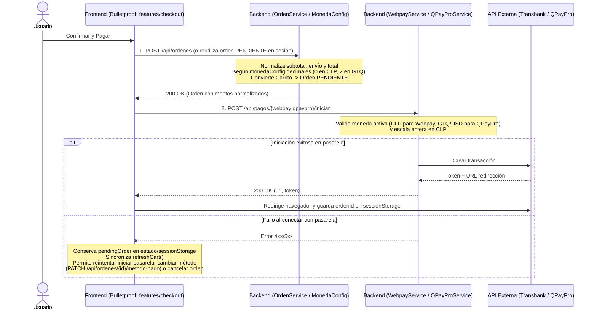

# Mejoras Sugeridas para Endpoints de Administración de Productos

> **Ámbito:** Documento de entrega para el equipo de **Backend** (`Spring Boot`). No se realizaron modificaciones en el código fuente del servidor.

---

## 1. Búsqueda por Nombre o SKU en `GET /api/productos/admin`

### Contexto
El panel de administración de productos ahora pagina directamente contra `GET /api/productos/admin` con un buscador por nombre o SKU (`?nombre=...`).  
Actualmente, en [`ProductoRepository.buscarTodosAdmin`](../src/main/java/com/jeplabs/ecommerce/domain/producto/ProductoRepository.java), el parámetro `:nombre` filtra únicamente por `p.nombre` y no trimmea cadenas vacías:

```sql
WHERE (:nombre IS NULL OR LOWER(p.nombre::varchar) LIKE LOWER(CONCAT('%', :nombre, '%')))
```

### Cambio sugerido
1. En `ProductoRepository.buscarTodosAdmin` (tanto en `value` como en `countQuery`), incluir `p.sku`:
   ```sql
   WHERE (:nombre IS NULL
       OR LOWER(p.nombre::varchar) LIKE LOWER(CONCAT('%', :nombre, '%'))
       OR LOWER(p.sku::varchar) LIKE LOWER(CONCAT('%', :nombre, '%')))
   ```
2. En `ProductoService.listarAdmin`, normalizar cadenas vacías o espacios a `null`:
   ```java
   String nombreFiltro = (nombre != null && !nombre.isBlank()) ? nombre.trim() : null;
   ```

---

## 2. Edición completa de productos `OCULTO` / `DESCONTINUADO` sin depender de endpoints públicos

### Contexto y causa raíz observada
Actualmente existen dos contratos distintos para consultar un producto por ID:
- **`GET /api/productos/{id}` (`DatosRespuestaProducto`):** endpoint público que usa `buscarProductoActivo(id)` (rechaza productos en estado `OCULTO` o `DESCONTINUADO`). Devuelve `descripcion`, `specs` y `categorias`.
- **`GET /api/productos/admin/{id}` (`DatosRespuestaProductoAdmin`):** endpoint admin que usa `buscarProducto(id)` (acepta todos los estados), pero solo devuelve:
  `id, sku, nombre, slug, stock, estado, precioVenta, precioCosto, margenPorcentaje, moneda, imagenes, createdAt, updatedAt`.
- **`GET /api/productos/{id}/imagenes`:** endpoint público que también ejecuta `buscarProductoActivo(id)` y falla con `Producto no encontrado` cuando el producto pasa a estar `OCULTO` o `DESCONTINUADO`.

Debido a esto, cualquier producto oculto o descontinuado no podía obtener su `descripcion`, `specs` ni `categorias` desde la API admin.

### Cambios sugeridos en Backend
1. **Ampliar [`DatosRespuestaProductoAdmin`](../src/main/java/com/jeplabs/ecommerce/domain/producto/DatosRespuestaProductoAdmin.java)** para incluir los campos necesarios en el formulario de edición:
   - `String descripcion`
   - `Map<String, Object> specs`
   - `List<DatosRespuestaCategoria> categorias`
2. **Anotar `buscarAdminPorId` y `listarAdmin` en `ProductoService` con `@Transactional(readOnly = true)`**, dado que `spring.jpa.open-in-view=false` requiere sesión activa para inicializar colecciones `LAZY` (`categorias`, `imagenes`, `precios`).
3. *(Opcional, buena práctica)* Exponer `GET /api/productos/admin/{id}/imagenes` (`@PreAuthorize("hasRole('ADMIN')")`) delegando en `buscarProducto(id)` en lugar de `buscarProductoActivo(id)` para mantener estricto el endpoint público y brindar consulta dedicada en admin.

---

## Arquitectura del Flujo Mejorado (Backend + Frontend)


