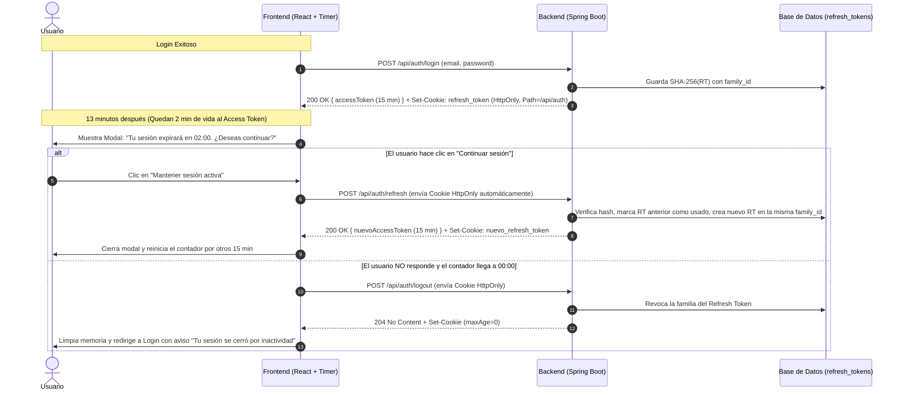

# Análisis de Arquitectura de Doble Token (Access + Refresh Token) en Spring Boot y Gestión de Sesión en E-Commerce

**Documento Evaluado:** [jwt-doble-token-spring-boot.md]()  
**Archivos de Código Relacionados:** [TokenService.java](), [AuthController.java](), [useAuthLogic.ts]()

---

## 1. Veredicto sobre el Documento `jwt-doble-token-spring-boot.md`

### ¿Es correcta la solución propuesta en el documento?
**Sí, es sobresaliente y se alinea al 100% con el estándar actual de la industria (IETF OAuth 2.0 Security Best Current Practice / OWASP Authentication Cheat Sheet).**

A diferencia de muchos tutoriales básicos que guardan el Refresh Token en texto plano o que usan un JWT sin estado como Refresh Token, tu documento [jwt-doble-token-spring-boot.md]() acierta en los **5 pilares más críticos de nivel bancario/e-commerce**:

1. **Separación Stateless vs. Stateful:**
   - **Access Token (AT):** Corta vida (5-15 min), *stateless* (JWT firmado con HMAC256). No golpea la base de datos en cada clic del usuario mientras navega el catálogo.
   - **Refresh Token (RT):** Larga vida (7-30 días), *stateful* (cadena opaca aleatoria de 256 bits persistida en base de datos). Permite revocación inmediata.
2. **Almacenamiento del Hash SHA-256 en Base de Datos (`token_hash`):**
   - Nunca se guarda el Refresh Token en crudo en la tabla `refresh_tokens`. Si un atacante comprometiera un backup de la base de datos, no podría usar los hashes para generar sesiones.
3. **Rotación de Refresh Token y Detección de Reutilización (`family_id`):**
   - Cada vez que se usa un RT para pedir un nuevo AT, el RT viejo se invalida (`revoked = true`) y se entrega uno nuevo perteneciente a la misma familia (`family_id`).
   - Si alguien intenta usar un RT que ya fue rotado, el backend detecta el robo y **revoca toda la familia de tokens de inmediato**, cerrando la sesión tanto del atacante como del dispositivo comprometido.
4. **Almacenamiento Seguro en el Navegador:**
   - **Access Token** en memoria de JavaScript (variable de estado en React), nunca en `localStorage`.
   - **Refresh Token** en Cookie `HttpOnly; Secure; SameSite=Strict` con `Path=/api/auth` (para que la cookie solo viaje cuando se invoca `/api/auth/refresh` o `/api/auth/logout`, y nunca en las demás llamadas a la API).
5. **Limpieza Automática (`@Scheduled`):**
   - Al igual que hicimos con la purga de carritos antiguos, un job nocturno purga de la base de datos los Refresh Tokens vencidos hace más de $N$ días.

---

## 2. Cómo Funciona para "Dar Opción al Usuario de Continuar su Sesión"

En tu consulta mencionaste un caso de uso clave:
> *"Esto es para cuando al usuario se le va a cerrar la sesión y se le pueda dar opción a continuar su sesión."*

En un e-commerce existen **dos patrones complementarios** que trabajan juntos con la arquitectura de Doble Token. Te explico cómo funcionan y cuál es la mejor práctica para combinarlos:

### Patrón A: Renovación Silenciosa (Silent Refresh) — *Mientras el usuario está activo*
Si el cliente está navegando productos, llenando su dirección de envío o en pleno checkout, **nunca debemos interrumpirlo con un cartel cada 15 minutos**.
- Cuando el Access Token (15 min) expira o está a 1 minuto de expirar y el usuario está activo, un interceptor del frontend llama en segundo plano a `POST /api/auth/refresh`.
- Como la cookie `HttpOnly` del Refresh Token es válida, el servidor rota el token y devuelve un nuevo Access Token de forma transparente.

### Patrón B: Modal de Advertencia por Inactividad ("¿Deseas continuar tu sesión?") — *Cuando el usuario deja la pestaña quieta*
Este es el flujo que buscas para proteger la cuenta si el usuario dejó su computadora abierta o lleva tiempo sin interactuar:

#### ¿Por qué el Doble Token es indispensable para este Modal?
1. **Con un solo token (implementación actual en tu código):**
   - Actualmente en [`useAuthLogic.ts`]() tienes un `setTimeout` que lee `getJwtExpiryMs(user.token)` y cuando llega a `0` ejecuta `invalidateClientSession({ reason: 'jwt_expired' })`, expulsando al usuario de golpe sin darle opción de extender la sesión porque no existe un endpoint de refresh.
2. **Con Doble Token (Access + Refresh):**
   - Como el Access Token vive en memoria de React, `useAuthLogic.ts` sigue leyendo su fecha de expiración (`getJwtExpiryMs(accessToken)`).
   - **2 minutos antes** de que expire (`msUntilExp - 120_000`), se activa un estado `isSessionExpiringSoon = true` que muestra un modal o banner con cuenta regresiva (igual de amigable que el que hicimos para el carrito).
   - Al pulsar **"Continuar sesión"**, el frontend invoca `POST /api/auth/refresh` (que usa el Refresh Token seguro en su cookie `HttpOnly`) y obtiene un nuevo Access Token sin pedirle la contraseña otra vez al usuario.

---

## 3. Mejoras y Ajustes Recomendados al Diseño de `jwt-doble-token-spring-boot.md`

El documento [jwt-doble-token-spring-boot.md]() es excelente conceptualmente. Para adaptarlo sin fricciones a **tu proyecto actual**, te recomiendo tener en cuenta estos **4 detalles técnicos específicos**:

### 3.1. Librería JWT: Mantener `com.auth0:java-jwt` (que ya usas)
- El documento menciona en la línea 71 `jjwt` o `nimbus-jose-jwt`.
- Tu proyecto ya tiene instalado y funcionando **`com.auth0:java-jwt`** en [`TokenService.java`]().
- **Mejor práctica:** No necesitas cambiar de librería ni agregar dependencias pesadas. `com.auth0:java-jwt` soporta nativamente `.withJWTId(UUID.randomUUID().toString())` (el claim `jti`) y todo lo necesario para el Access Token.

### 3.2. Ventana de Gracia (*Leeway*) en la Rotación por Peticiones Concurrentes
- En aplicaciones React, a veces se disparan dos peticiones casi al mismo segundo o dos pestañas intentan refrescar al mismo tiempo.
- **Mejor práctica:** Al implementar el método `refresh()`, usar bloqueo pesimista en la consulta (`@Lock(LockModeType.PESSIMISTIC_WRITE)`) o una pequeña ventana de tolerancia (ej. 5 segundos) o bien sincronizar en el frontend con un *singleton promise* (*refresh lock*) para que si hay 3 peticiones esperando un nuevo token, solo se haga **1 llamada** a `POST /api/auth/refresh`.

### 3.3. Recarga de Página (F5) cuando el Access Token está en Memoria
- Si el Access Token se guarda en memoria de React (y no en `localStorage`), cuando el usuario presiona **F5 (recargar página)**, la memoria de JS se limpia.
- **Mejor práctica:** Al inicializar la app en `useAuthLogic.ts` (en el `useEffect` de montaje), si había una bandera no sensible en `localStorage` como `has_active_session=true`, el frontend llama automáticamente una vez a `POST /api/auth/refresh`. El navegador adjunta la cookie `HttpOnly` del Refresh Token y el usuario recupera su Access Token en milisegundos sin perder su sesión al dar F5.

### 3.4. Diferenciación por Rol (Cliente vs. Admin)
- Tal como sugiere la línea 116 de tu documento:
  - **Rol `CLIENTE`:** Access Token de **15-30 minutos** y Refresh Token de **14-30 días** (prioriza no interrumpir compras ni perder carritos).
  - **Rol `ADMIN`:** Access Token de **10-15 minutos** y Refresh Token de **24 horas** (prioriza seguridad de backoffice).

---

## 4. Comparativa: Estado Actual del Proyecto vs. Arquitectura Doble Token

| Característica | Implementación Actual en tu Proyecto | Arquitectura Doble Token Propuesta |
| :--- | :--- | :--- |
| **Cantidad de Tokens** | 1 solo JWT | **2 Tokens** (Access JWT + Refresh Opaco) |
| **Almacenamiento** | `localStorage` (vulnerable a XSS) | Access en **Memoria** + Refresh en **Cookie `HttpOnly`** |
| **Qué pasa cuando expira el JWT** | [`useAuthLogic.ts`]() cierra la sesión de golpe sin opción a continuar | Muestra modal *"¿Deseas continuar tu sesión?"* y renueva vía `/api/auth/refresh` |
| **Revocación en Logout o Cambio de Clave** | No revocable en el servidor (sigue vivo hasta expirar) | **Revocación inmediata** en BD (`revoked = true`) |
| **Detección de Robo de Sesión** | Ninguna | **Detección de reúso por `family_id`** (revoca toda la cadena) |

---

## 5. Conclusión

El documento [jwt-doble-token-spring-boot.md]() plantea **exactamente la arquitectura correcta y de mejor práctica profesional**. Además, resuelve de forma mucho más limpia y segura el objetivo del primer documento (`Evaluacion-Seguridad-Frontend.md`), ya que elimina el JWT de `localStorage`, protege el Refresh Token en una cookie `HttpOnly` aislada al path `/api/auth`, y habilita el flujo interactivo para que el usuario pueda extender su sesión cuando esté próxima a expirar.
