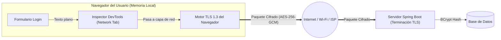

# Análisis de Seguridad Frontend: Tráfico de Credenciales en DevTools y Almacenamiento de Tokens

**Documento Evaluado:** [Evaluacion-Seguridad-Frontend.md]()  
**Archivos de Código Relacionados:** [useAuthLogic.ts](), [AuthController.java]()

---

## 1. Diagnóstico sobre las Credenciales Visibles en DevTools (Network Tab)

### ¿Es una vulnerabilidad que la contraseña se vea en la pestaña Network al hacer Login?
**No. Es el comportamiento estándar, esperado y correcto de todos los navegadores web modernos (incluidos Google, Amazon, GitHub y Stripe).**

#### ¿Por qué ocurre esto?

1. **Frontera de Confianza Local:** Las herramientas de desarrollador (*DevTools*) forman parte del propio navegador y se ejecutan **antes** de que el motor de red cifre la petición con TLS/HTTPS. Quien tiene acceso a las DevTools de una pestaña activa ya tiene control total sobre lo que el usuario escribe en el teclado (podría leer `input.value` desde la consola).
2. **En tránsito por la red va 100% cifrado:** Apenas el paquete abandona el navegador rumbo al servidor sobre **HTTPS (TLS 1.2 / TLS 1.3)**, todo el cuerpo JSON (`{ "email": "...", "password": "..." }`), las cabeceras y la ruta viajan cifrados de extremo a extremo. Ningún atacante en la misma red Wi-Fi o en internet puede ver el contenido.

---

## 2. Evaluación del Documento `Evaluacion-Seguridad-Frontend.md`

El documento [Evaluacion-Seguridad-Frontend.md]() se divide en tres partes. A continuación se evalúa qué es **100% correcto** y qué requiere **un matiz importante de arquitectura**:

### 2.1. Aciertos Totales del Documento (Lo que está excelente)
1. **Rechazo al uso de `CryptoJS` o hashing en el Frontend (Sección 2.2):**
   - **Veredicto:** **Totalmente acertado.**
   - **Por qué:** Cifrar o hashear la contraseña en el cliente con una clave estática en JavaScript es teatro de seguridad (*Security Theater*). Si el frontend transforma `"MiClave123"` en `"a8f5f167f44f4964e6c998dee827110c"`, ese hash pasa a ser la contraseña real frente al backend (*Pass-the-Hash* / *Replay Attack*). Además, como el código JS se descarga en el navegador, cualquier atacante puede ver la llave o el algoritmo en segundos.
2. **Corrección de XSS eliminando `dangerouslySetInnerHTML` (Sección 3.1):**
   - **Veredicto:** **Excelente práctica.** Usar `white-space: pre-wrap` en CSS en lugar de inyectar HTML crudo cierra la puerta a ataques de Cross-Site Scripting (XSS) almacenados en descripciones de productos.
3. **Encabezados de Seguridad HTTP en `netlify.toml` (Sección 3.2):**
   - **Veredicto:** **Correcto**, aunque en la directiva `Content-Security-Policy` convendría a futuro refinar `connect-src` para listar explícitamente el dominio de tu backend y pasarelas de pago en lugar de `http: https:` abiertos.

---

### 2.2. Observación Crítica sobre la Sección 4 (Cookie `HttpOnly` con un solo JWT de 24h)

En la **Sección 4**, el documento propone mover el **único JWT (con duración de 24 horas)** desde `localStorage` hacia una Cookie `HttpOnly` con `Path=/`.

> [!WARNING]
> **Matiz Arquitectónico Importante:**
> Guardar un único Access Token de larga duración (24h) en una cookie `HttpOnly` que se envía automáticamente en `Path=/` tiene **tres problemas en arquitecturas modernas**:
> 1. **El token sigue siendo irrevocable por 24 horas:** Si el usuario cierra sesión (`POST /logout`), se borra la cookie en su navegador, pero si el token fue interceptado o copiado antes, sigue siendo criptográficamente válido en el backend hasta que pasen las 24 horas.
> 2. **Exposición a CSRF y problemas Cross-Domain:** Si el frontend está en Netlify (`tu-tienda.netlify.app`) y el backend en Render/Railway/AWS (`api.tu-tienda.com`), las cookies `SameSite=Lax` **no se envían en peticiones `fetch` cross-domain** a menos que ambos compartan el mismo dominio raíz (ej. `tienda.com` y `api.tienda.com`). Si fuerzas `SameSite=None; Secure`, abres la puerta a ataques **CSRF** en todos tus endpoints (`POST /api/ordenes`, `DELETE /api/carrito`, etc.) y además navegadores como Safari (ITP) y Chrome con bloqueo de cookies de terceros las bloquean.
> 3. **Pérdida de visibilidad del tiempo de expiración en el Frontend:** Como JavaScript no puede leer una cookie `HttpOnly`, el frontend pierde la capacidad de leer el claim `exp` ([useAuthLogic.ts]() para mostrar un modal preventivo de *"Tu sesión está por expirar, ¿deseas continuar?"*.

---

## 3. ¿Cuál es la Mejor Solución a Aplicar y la Mejor Práctica de la Industria?

### 3.1. Para las Credenciales en el Login (DevTools)
**La mejor práctica es NO tocar ni ofuscar el payload de login en el frontend.** Mantener el envío limpio `{ email, password }` sobre HTTPS y proteger el proceso de autenticación con estas **4 medidas reales de seguridad** (algunas ya presentes en tu proyecto):

1. **TLS/HTTPS Estricto (HSTS):** En producción, todas las comunicaciones van sobre HTTPS y se incluye la cabecera `Strict-Transport-Security: max-age=31536000; includeSubDomains`.
2. **Atributos HTML Estándar en el Input de Contraseña:**
   - Usar `type="password"` y `autoComplete="current-password"`.
   - Nunca guardar el password en `localStorage`, `sessionStorage`, URL query params ni en logs de `console.log` o reportes de error (Sentry).
3. **Hashing con Factor de Trabajo Alto en el Backend:**
   - Continuar utilizando `BCryptPasswordEncoder` en Spring Security (que incluye un *salt* aleatorio único por cada usuario).
4. **Bloqueo Temporal y Rate Limiting contra Fuerza Bruta:**
   - Tu [`AuthController.java`]() ya implementa `verificarBloqueoExpirado` y `procesarLoginFallido`, lo cual es una excelente práctica defensiva.

---

### 3.2. Para el Manejo del Token en el Navegador (Conexión con Doble Token)

En lugar de meter un único token de 24 horas en una cookie global (`Path=/`), **la mejor práctica según OWASP y OAuth 2.0 Security Best Current Practice (RFC 9700)** es combinar lo mejor de ambos documentos mediante **Arquitectura Híbrida de Doble Token**:

| Elemento | Dónde se almacena | Tiempo de Vida | Cómo viaja al Backend | Por qué es la Mejor Práctica |
| :--- | :--- | :--- | :--- | :--- |
| **Access Token (JWT)** | **En memoria de React** (estado / variable en memoria, NO en `localStorage`) | Corto (**10 - 15 min**) | Header `Authorization: Bearer <token>` | 1. Inmune a CSRF. 2. Inmune a robo persistente en `localStorage`. 3. El frontend puede leer el `exp` para mostrar el aviso *"¿Continuar sesión?"*. |
| **Refresh Token (Opaco)** | **Cookie `HttpOnly; Secure; SameSite=Strict`** | Largo (**7 - 30 días**) | Automático, **restringido solo a** `Path=/api/auth` | 1. Inmune a XSS (`HttpOnly`). 2. No viaja en cada petición a la API, solo cuando se pide renovar o cerrar sesión. 3. Revocable en Base de Datos en cualquier instante. |

---

## 4. Resumen de Recomendaciones Accionables

1. **Tráfico en Network Tab:** Dejar el envío de `{ email, password }` tal como está sobre HTTPS. Explicar al equipo que lo visible en DevTools ocurre dentro de la memoria local del propio usuario antes del cifrado TLS, y que usar `CryptoJS` en el cliente introduciría vulnerabilidades de *Pass-the-Hash*.
2. **Prevención de XSS:** Mantener el código libre de `dangerouslySetInnerHTML` y conservar los headers de seguridad en `netlify.toml`.
3. **Evolución de la Sesión:** En lugar de aplicar la Sección 4 de `Evaluacion-Seguridad-Frontend.md` (cookie global de un solo token), implementar directamente la **Arquitectura de Doble Token (Access Token en memoria + Refresh Token en Cookie `HttpOnly` con Path restringido)** detallada en el segundo documento de análisis.
