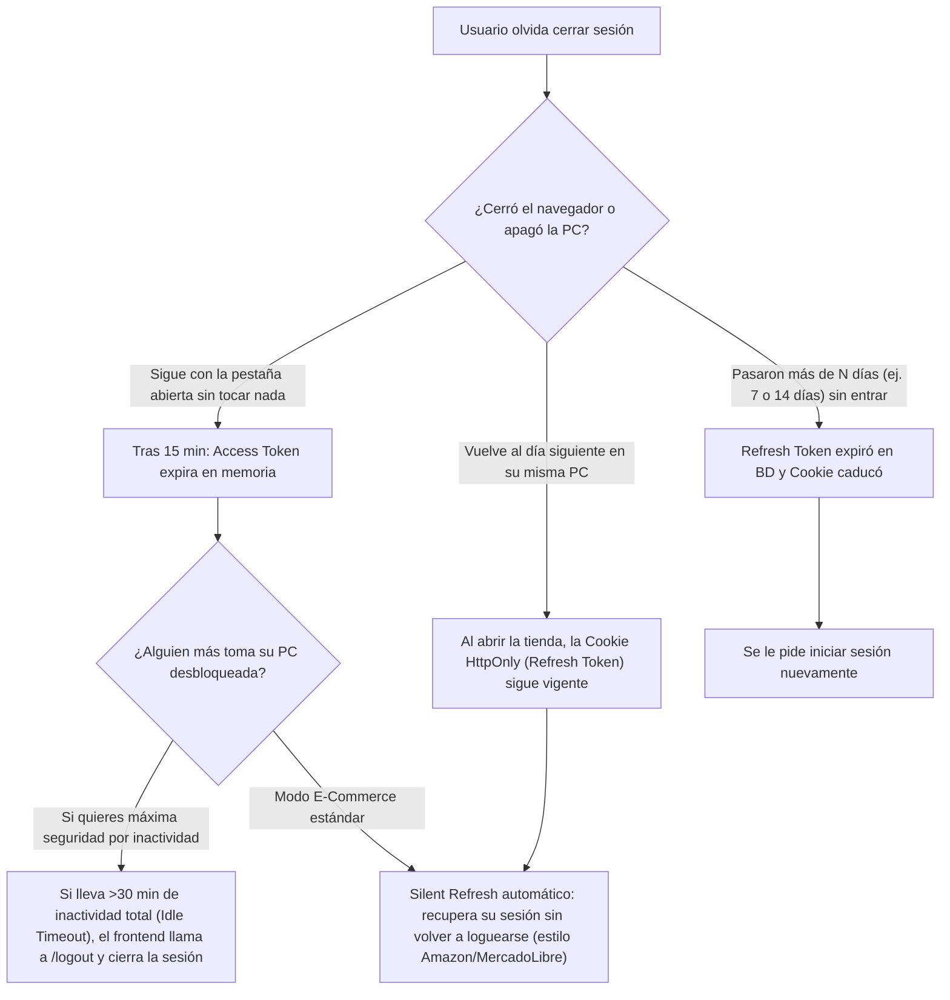

# Plan de Implementación: Arquitectura de Doble Token (Access + Refresh) con Renovación Silenciosa

## Objetivo
Implementar en el **Backend (Spring Boot)** la arquitectura estándar de la industria de **Doble Token (Access Token JWT + Refresh Token Opaco en Cookie `HttpOnly`)** con rotación automática, detección de robo/reúso por familia de sesión (`family_id`), revocación inmediata en eventos críticos (logout, cambio/reseteo de contraseña, desactivación de usuario) y limpieza programada, todo parametrizado mediante variables de entorno. Además, se incluye la **Guía de Integración para Frontend** enfocada en **Renovación Silenciosa (*Silent Refresh*)** transparente para el usuario.

---

## Respuestas a las 3 Preguntas Clave de Arquitectura

### 1. ¿Al cerrar sesión qué pasa con el Access Token y con el Refresh Token?
Cuando el usuario hace clic en **"Cerrar sesión" (`POST /api/auth/logout`)** ocurre una doble limpieza coordinada entre cliente y servidor:
- **Con el Refresh Token (Stateful):**
  1. El navegador envía automáticamente la cookie `HttpOnly` (`refresh_token`) al endpoint `/api/auth/logout`.
  2. El backend calcula su hash SHA-256, busca la sesión en la tabla `refresh_tokens` y **marca toda la familia (`family_id`) como revocada (`revocado = true`)** en la base de datos.
  3. El backend responde con una cabecera `Set-Cookie: refresh_token=; Max-Age=0; HttpOnly` que destruye la cookie en el navegador de inmediato.
- **Con el Access Token (Stateless):**
  1. El frontend **borra inmediatamente el Access Token de la memoria de React** (y limpia el estado de usuario/carrito en cliente).
  2. Como ya no existe en la memoria del navegador ni hay Refresh Token válido para pedir otro, la sesión muere en el acto para el usuario. Si alguien hubiera copiado el Access Token antes del logout, este caducará por sí solo en los pocos minutos restantes de su corta vida (ej. 10-15 min).

---

### 2. ¿Cómo saber que un usuario está navegando aún o ya no?
La detección de actividad ocurre en dos capas complementarias:
1. **Actividad de Red (Implícita por llamadas a la API):**
   - Mientras el usuario navega por categorías, abre detalles de productos, modifica su carrito o pasa al checkout, el frontend realiza peticiones HTTP (`fetch`).
   - Si en cualquiera de esas llamadas el Access Token (15 min) ya venció o está a menos de 60 segundos de vencer, el **interceptor de cliente ejecuta un *Silent Refresh* (`POST /api/auth/refresh`)** antes o durante la petición, renovando el token de forma 100% invisible.
2. **Actividad de Interfaz en el Navegador (Eventos DOM con *Throttle*):**
   - ¿Qué pasa si el usuario está leyendo reseñas o llenando un formulario largo durante 16 minutos sin disparar llamadas a la API?
   - El frontend registra un detector ligero de actividad (`mousemove`, `keydown`, `click`, `scroll`, `touchstart`) que actualiza en memoria un timestamp `lastActivityAt` (con *throttle* cada 30 segundos para no afectar el rendimiento).
   - Un temporizador verifica cuando al Access Token le queda **1 minuto de vida**:
     - **Si hubo actividad reciente** (ej. el usuario movió el mouse o escribió en los últimos 10 minutos): el frontend dispara `POST /api/auth/refresh` en segundo plano (renovación silenciosa) sin mostrar ningún mensaje.
     - **Si NO hubo actividad** (pestaña abandonada): no pide un nuevo Access Token innecesariamente; el Access Token expira en memoria, pero el Refresh Token sigue guardado en su cookie `HttpOnly` listo para renovar silenciosamente apenas el usuario vuelva a interactuar.

---

### 3. ¿Qué pasa si el usuario olvidó cerrar su sesión?
Depende del escenario y de los tiempos configurados en tus variables de entorno:



- **Protección de operaciones críticas:** Aunque el usuario olvide cerrar sesión, para cambiar su contraseña (`PATCH /api/usuarios/perfil/password`) el backend ya exige ingresar la `passwordActual`.
- **Diferenciación por Rol (Cliente vs. Admin):**
  - Para un **`CLIENTE`**: el Refresh Token dura **7 a 14 días** (si olvida cerrar sesión en su casa, al volver mañana sigue logueado para no perder ventas ni carritos).
  - Para un **`ADMIN`**: configuramos un Refresh Token mucho más corto (**12 a 24 horas**) y Access Token de **10 minutos**, de modo que si un administrador olvida cerrar sesión, su sesión caduque rápidamente.

---

## Revisión Requerida del Usuario

> [!IMPORTANT]
> **Compatibilidad hacia atrás durante la transición del Frontend:**
> - El endpoint `POST /api/auth/login` seguirá devolviendo `DatosRespuestaToken` con el Access Token en el campo `token` del JSON **y además** adjuntará la cookie `HttpOnly` `refresh_token`. Esto garantiza que **ningún test actual ni el frontend actual se rompan** mientras realizas el ajuste en el frontend.
> - El filtro `FiltroSeguridad` seguirá leyendo el Access Token desde el header `Authorization: Bearer <accessToken>`, manteniendo la API 100% inmune a ataques CSRF en los endpoints de negocio.

---

## Cambios Propuestos en el Backend

### 1. Base de Datos (Migración Flyway)

#### [NEW] [V26__create_refresh_tokens.sql](file:ecommerce/backend/src/main/resources/db/migration/V26__create_refresh_tokens.sql)
Crea la tabla `refresh_tokens` con soporte para hash SHA-256, rotación por familia (`family_id`), trazabilidad de reemplazo y metadatos básicos de auditoría (`ip`, `user_agent`):

```sql
CREATE TABLE refresh_tokens (
    id              BIGSERIAL PRIMARY KEY,
    usuario_id      BIGINT NOT NULL REFERENCES usuarios(id) ON DELETE CASCADE,
    token_hash      VARCHAR(64) NOT NULL UNIQUE,
    family_id       VARCHAR(36) NOT NULL,
    expira_at       TIMESTAMP NOT NULL,
    revocado        BOOLEAN NOT NULL DEFAULT FALSE,
    reemplazado_por BIGINT REFERENCES refresh_tokens(id),
    creado_at       TIMESTAMP NOT NULL DEFAULT NOW(),
    ip_address      VARCHAR(45),
    user_agent      VARCHAR(512)
);

CREATE INDEX idx_refresh_tokens_usuario_id ON refresh_tokens(usuario_id);
CREATE INDEX idx_refresh_tokens_family_id ON refresh_tokens(family_id);
CREATE INDEX idx_refresh_tokens_expira_at ON refresh_tokens(expira_at);
```

---

### 2. Dominio de Usuario / Refresh Token

#### [NEW] [RefreshToken.java](file:/ecommerce/backend/src/main/java/com/jeplabs/ecommerce/domain/usuario/RefreshToken.java)
Entidad JPA mapeada a `refresh_tokens` con métodos de dominio claros (`estaExpirado()`, `revocar()`, `marcarReemplazadoPor(RefreshToken nuevo)`).

#### [NEW] [RefreshTokenRepository.java](file:/ecommerce/backend/src/main/java/com/jeplabs/ecommerce/domain/usuario/RefreshTokenRepository.java)
Repositorio con consultas transaccionales para rotación, revocación por familia, revocación total por usuario y purga de tokens antiguos:
- `Optional<RefreshToken> findByTokenHash(String tokenHash)` (con `@Lock(LockModeType.PESSIMISTIC_WRITE)` para evitar condiciones de carrera si dos pestañas refrescan al mismo milisegundo).
- `@Modifying @Query("UPDATE RefreshToken r SET r.revocado = true WHERE r.familyId = :familyId AND r.revocado = false") int revocarFamilia(String familyId)`
- `@Modifying @Query("UPDATE RefreshToken r SET r.revocado = true WHERE r.usuario.id = :usuarioId AND r.revocado = false") int revocarTodosPorUsuario(Long usuarioId)`
- `@Modifying @Query("DELETE FROM RefreshToken r WHERE (r.revocado = true OR r.expiraAt < :ahora) AND r.creadoAt < :limiteRetencion") int purgarTokensAntiguos(LocalDateTime ahora, LocalDateTime limiteRetencion)`

#### [NEW] [RefreshTokenService.java](file:/ecommerce/backend/src/main/java/com/jeplabs/ecommerce/domain/usuario/RefreshTokenService.java)
Servicio transaccional encargado del ciclo de vida completo del Refresh Token:
- **Generación criptográfica:** Usa `SecureRandom` (32 bytes = 256 bits codificados en Base64 URL-safe) para el token crudo y `MessageDigest` (`SHA-256`) para guardar únicamente el `token_hash` en base de datos.
- **Duración diferenciada por rol:**
  - `ROLE_ADMIN`: usa `${api.security.refresh-expiration-admin-days}`
  - `ROLE_CLIENTE`: usa `${api.security.refresh-expiration-cliente-days}`
- **Rotación y Detección de Reutilización (`rotarToken`):**
  - Si un token ya fue marcado como `revocado = true` y se intenta volver a usar: **revoca inmediatamente toda la `family_id`**, registra una alerta en el log de seguridad y lanza `RefreshTokenInvalidoException`.
  - Si el usuario fue desactivado (`!usuario.isActivo()`), revoca la familia y rechaza la renovación.
  - Si es válido, marca el actual como `revocado = true`, crea un nuevo `RefreshToken` con el mismo `family_id`, enlaza `reemplazadoPor` y retorna el nuevo par `(AccessToken, RawRefreshToken, Usuario)`.

#### [NEW] [RefreshTokenInvalidoException.java](file:/ecommerce/backend/src/main/java/com/jeplabs/ecommerce/infra/exceptions/RefreshTokenInvalidoException.java)
Excepción específica manejada en `GestorDeErrores` para devolver `HTTP 401 Unauthorized` con `{ "error": "...", "codigo": "REFRESH_TOKEN_INVALIDO" }`.

---

### 3. Infraestructura de Seguridad, Cookies y Scheduler

#### [MODIFY] [TokenService.java](file:/ecommerce/backend/src/main/java/com/jeplabs/ecommerce/infra/security/TokenService.java)
- Agregar claim `.withJWTId(UUID.randomUUID().toString())` (`jti`) para que cada Access Token sea único.
- Soportar tiempo de vida diferenciado por rol mediante variables de entorno (manteniendo compatibilidad con `api.security.expiration` como fallback):
  - `api.security.access-expiration-cliente-seconds` (ej. `900` = 15 min)
  - `api.security.access-expiration-admin-seconds` (ej. `600` = 10 min)

#### [NEW] [RefreshCookieHelper.java](file:/ecommerce/backend/src/main/java/com/jeplabs/ecommerce/infra/security/RefreshCookieHelper.java)
Componente encargado de construir, leer y expirar la Cookie `HttpOnly` usando `ResponseCookie` de Spring, parametrizado con variables de entorno:
- `api.security.cookie.name` (default: `refresh_token`)
- `api.security.cookie.secure` (`false` en dev local sobre HTTP, `true` en producción sobre HTTPS)
- `api.security.cookie.same-site` (`Lax` en dev, `Strict` o `Lax` en prod)
- `api.security.cookie.path` (default: `/api/auth` — **la cookie nunca viaja en peticiones al resto de la API, solo a `/api/auth/*`**)

#### [MODIFY] [SecurityConfigurations.java](file:/ecommerce/backend/src/main/java/com/jeplabs/ecommerce/infra/security/SecurityConfigurations.java)
- Permitir acceso público a `.requestMatchers(HttpMethod.POST, "/api/auth/refresh").permitAll()` y `.requestMatchers(HttpMethod.POST, "/api/auth/logout").permitAll()` (ya que estos endpoints se autentican mediante la cookie `HttpOnly` del Refresh Token incluso cuando el Access Token ya expiró).
- **Integración de `analisis_seguridad_frontend_credenciales.md` (Cabeceras de Seguridad HTTP en el Backend):**
  Configurar explícitamente en el `SecurityFilterChain` los encabezados defensivos recomendados por OWASP para proteger las respuestas de autenticación y transporte:
  - **HSTS (`Strict-Transport-Security`):** Fuerza a que el navegador solo se comunique por HTTPS en producción (`max-age=31536000; includeSubDomains`), protegiendo el tránsito de `{ email, password }`.
  - **`Cache-Control: no-store`:** Garantiza que ni el navegador ni proxies intermedios almacenen en caché en disco las respuestas de `/api/auth/login` o `/api/auth/refresh`.
  - **`X-Content-Type-Options: nosniff`** y **`X-Frame-Options: DENY`**.

#### [MODIFY] [CorsConfig.java](file:/ecommerce/backend/src/main/java/com/jeplabs/ecommerce/infra/config/CorsConfig.java)
- Inyectar los orígenes permitidos desde variable de entorno `@Value("${api.cors.allowed-origins}")` en lugar de tenerlos fijos en código duro, manteniendo `setAllowCredentials(true)`.

#### [NEW] [RefreshTokenScheduler.java](file:/ecommerce/backend/src/main/java/com/jeplabs/ecommerce/infra/scheduler/RefreshTokenScheduler.java)
- Job programado (`@Scheduled(cron = "${api.security.refresh-purge-cron:0 30 3 * * *}")`) que se ejecuta en la madrugada para eliminar físicamente de la BD los Refresh Tokens expirados o revocados que superen los días de retención (`${api.security.refresh-retention-days:30}`).

---

### 4. Controladores y Revocación Automática en Eventos de Seguridad

#### [MODIFY] [AuthController.java](file:/ecommerce/backend/src/main/java/com/jeplabs/ecommerce/controller/AuthController.java)
1. **`POST /api/auth/login`:**
   - Genera el Access Token y crea la familia inicial de Refresh Token (registrando IP y User-Agent del request).
   - Adjunta la cookie `HttpOnly` `refresh_token` en el `HttpServletResponse`.
   - Devuelve `DatosRespuestaToken`.
2. **`POST /api/auth/refresh` (Nuevo):**
   - Extrae el `refresh_token` de la cookie `HttpOnly`.
   - Llama a `refreshTokenService.rotarToken(...)`.
   - Escribe la nueva cookie `HttpOnly` con el Refresh Token rotado y devuelve `DatosRespuestaToken` con el nuevo Access Token.
   - Si el token es inválido, expiró o se detectó reúso, limpia la cookie (`maxAge = 0`) y responde `401 Unauthorized`.
3. **`POST /api/auth/logout` (Nuevo):**
   - Si viene la cookie `refresh_token`, revoca toda la familia en base de datos.
   - Limpia la cookie (`maxAge = 0`) y devuelve `204 No Content`.
4. **`POST /api/auth/logout-all` (Nuevo - Requiere autenticación):**
   - Permite al usuario cerrar todas sus sesiones activas en todos los dispositivos (`revocarTodosPorUsuario`), limpia la cookie actual y devuelve `204 No Content`.

#### [MODIFY] [AutenticacionService.java](file:/ecommerce/backend/src/main/java/com/jeplabs/ecommerce/domain/usuario/AutenticacionService.java) y [PasswordResetService.java](file:/ecommerce/backend/src/main/java/com/jeplabs/ecommerce/domain/usuario/PasswordResetService.java)
- Al **cambiar la contraseña** (`actualizarPassword`), **restablecer contraseña olvidada** (`resetearPassword`), **cambiar el rol** (`actualizarRol`) o **desactivar un usuario** (`actualizarEstado` con `activo = false`): se invoca automáticamente `refreshTokenService.revocarTodasLasSesionesUsuario(usuario.getId())`.

---

### 5. Variables de Entorno y Propiedades

#### [MODIFY] [application.properties](file:/ecommerce/backend/src/main/resources/application.properties) y [application-dev.properties](file:///C:/Users/alexe/Desktop/2026-Projects/e-commerce/ecommerce/backend/src/main/resources/application-dev.properties)

```properties
# ==========================================
# SEGURIDAD JWT - DOBLE TOKEN (ACCESS + REFRESH)
# ==========================================
api.security.secret=${JWT_SECRET:123456789}
# Fallback general en segundos (15 min)
api.security.expiration=${JWT_ACCESS_EXPIRATION_SECONDS:900}
# Expiracion de Access Token por rol en segundos (Cliente: 15 min, Admin: 10 min)
api.security.access-expiration-cliente-seconds=${JWT_ACCESS_CLIENTE_SECONDS:900}
api.security.access-expiration-admin-seconds=${JWT_ACCESS_ADMIN_SECONDS:600}

# Expiracion de Refresh Token por rol en dias (Cliente: 14 dias, Admin: 1 dia)
api.security.refresh-expiration-cliente-days=${JWT_REFRESH_CLIENTE_DAYS:14}
api.security.refresh-expiration-admin-days=${JWT_REFRESH_ADMIN_DAYS:1}

# Configuracion de Cookie HttpOnly para Refresh Token
api.security.cookie.name=${JWT_REFRESH_COOKIE_NAME:refresh_token}
api.security.cookie.secure=${JWT_REFRESH_COOKIE_SECURE:false}
api.security.cookie.same-site=${JWT_REFRESH_COOKIE_SAMESITE:Lax}
api.security.cookie.path=${JWT_REFRESH_COOKIE_PATH:/api/auth}

# Retencion y purga de Refresh Tokens en BD
api.security.refresh-retention-days=${JWT_REFRESH_RETENTION_DAYS:30}
api.security.refresh-purge-cron=${JWT_REFRESH_PURGE_CRON:0 30 3 * * *}

# CORS Origenes permitidos
api.cors.allowed-origins=${CORS_ALLOWED_ORIGINS:http://localhost:5173,http://127.0.0.1:5173,http://localhost:3000}
```

---

## Guía de Implementación para el Frontend (Seguridad de Credenciales + Renovación Silenciosa)

> [!NOTE]
> Esta sección consolida en una sola guía tanto las buenas prácticas de **protección de credenciales y prevención XSS** (de `analisis_seguridad_frontend_credenciales.md`) como la **Renovación Silenciosa (*Silent Refresh*)** con Doble Token.

### Paso 0: Higiene de Credenciales en Login y Cabeceras CSP (`analisis_seguridad_frontend_credenciales.md`)
1. **No cifrar ni hashear con `CryptoJS` en el cliente:**
   - Enviar `{ email, password }` directamente sobre **HTTPS** en `POST /api/auth/login`.
   - Limpiar inmediatamente la variable `password` del estado del formulario (`setPassword('')`) en el bloque `finally` tras la petición, y jamás registrarla en `console.log` ni en reportes de error.
   - Asegurar en los inputs de contraseña los atributos estándar `type="password"` y `autoComplete="current-password"` (en login) o `autoComplete="new-password"` (en registro/cambio de clave).
2. **Refinar `Content-Security-Policy` en `netlify.toml`:**
   - Restringir `connect-src` a los orígenes legítimos (`'self'` y la URL del backend/pasarelas) e incluir `Strict-Transport-Security` para forzar HTTPS:
   ```toml
   [[headers]]
     for = "/*"
     [headers.values]
       Strict-Transport-Security = "max-age=31536000; includeSubDomains; preload"
       X-Frame-Options = "DENY"
       X-Content-Type-Options = "nosniff"
       Referrer-Policy = "strict-origin-when-cross-origin"
   ```

### Paso 1: Almacenamiento del Access Token en Memoria (Eliminando `localStorage.getItem('token')`)
En lugar de guardar el JWT en `localStorage` (donde sería vulnerable a robo por XSS), se mantiene únicamente en un módulo en memoria (`auth-token-store.ts`) y se guarda en `localStorage` solo una bandera booleana no sensible `has_session = '1'` para saber al recargar la página (F5) si debemos invocar `/api/auth/refresh`.

```ts
// src/shared/lib/auth-token-store.ts
let inMemoryToken: string | null = null;

export const getAccessToken = () => inMemoryToken;
export const setAccessToken = (token: string | null) => {
    inMemoryToken = token;
    if (token) {
        localStorage.setItem('has_session', '1');
        // Asegurarnos de borrar cualquier token legado que haya quedado en localStorage
        localStorage.removeItem('token');
    } else {
        localStorage.removeItem('has_session');
        localStorage.removeItem('token');
    }
};
```

### Paso 2: Función de Refresh con *Singleton Lock* (Evita Condiciones de Carrera)
Si 3 componentes piden datos al mismo tiempo cuando el Access Token acaba de expirar, el *lock* garantiza que solo se haga **1 llamada** a `POST /api/auth/refresh` y las 3 peticiones compartan el nuevo token:

```ts
let refreshPromise: Promise<DatosRespuestaToken | null> | null = null;

export async function silentRefresh(): Promise<DatosRespuestaToken | null> {
    if (refreshPromise) return refreshPromise;

    refreshPromise = fetch(`${API_URL}/api/auth/refresh`, {
        method: 'POST',
        credentials: 'include', // <-- Envía la cookie HttpOnly refresh_token a /api/auth/refresh
    })
        .then(async (res) => {
            if (!res.ok) {
                setAccessToken(null);
                return null;
            }
            const data = await res.json();
            setAccessToken(data.token);
            return data;
        })
        .catch(() => {
            setAccessToken(null);
            return null;
        })
        .finally(() => {
            refreshPromise = null;
        });

    return refreshPromise;
}
```

### Paso 3: Detector de Actividad y Renovación Silenciosa Proactiva en `useAuthLogic.ts`
Para saber si el usuario sigue navegando y renovar su Access Token sin mostrarle ningún modal:
1. **Registro ligero de actividad (DOM):** Escuchar `pointerdown`, `keydown`, `scroll` con *throttle* de 30 segundos actualizando `lastActivityRef.current = Date.now()`.
2. **Timer 60 segundos antes de expirar (`expMs - Date.now() - 60_000`):**
   - Si el usuario tuvo actividad reciente (ej. en los últimos 15 minutos), ejecuta `await silentRefresh()` en segundo plano y actualiza el token en memoria sin ninguna interrupción visual.
   - Si la pestaña quedó inactiva y el Access Token venció, en cuanto el usuario vuelva a hacer clic o cambiar a la pestaña (`visibilitychange` / interceptor HTTP `401`), `silentRefresh()` obtendrá un nuevo Access Token usando la cookie `HttpOnly` del Refresh Token.
3. **Recarga de página (F5):** Si `localStorage.getItem('has_session') === '1'`, el `useEffect` inicial llama a `silentRefresh()` antes de pasar `loading` a `false`.
4. **Cierre de sesión (`logout`):** Llama a `POST /api/auth/logout` con `credentials: 'include'` (para que el backend revoque la familia en BD y borre la cookie `HttpOnly`) y ejecuta `setAccessToken(null)`.

---

## Plan de Verificación

### Pruebas Automatizadas (Backend)
Se creará una suite completa de pruebas unitarias y de integración (`RefreshTokenServiceTest.java`) que validará:
1. Emisión de Refresh Token y verificación de que en BD solo se guarda el hash SHA-256 (64 caracteres hex) y nunca el token en texto plano.
2. Rotación exitosa (`rotarToken`): el token anterior queda `revocado = true`, apunta a `reemplazadoPor`, y el nuevo conserva el mismo `family_id`.
3. **Detección de robo/reúso:** al intentar usar un Refresh Token ya rotado, se revoca automáticamente toda la familia (`family_id`) y se lanza `RefreshTokenInvalidoException`.
4. Revocación automática de todas las sesiones del usuario al cambiar contraseña o desactivar cuenta.
5. Purga de tokens expirados/revocados mediante `RefreshTokenScheduler`.

Comando de ejecución:
```powershell
./mvnw test -Dtest=RefreshTokenServiceTest,*Auth*,*Carrito*
```

### Verificación Manual (Swagger / Postman / Navegador)
1. Hacer `POST /api/auth/login` y verificar en las cabeceras de respuesta la presencia de `Set-Cookie: refresh_token=...; Path=/api/auth; HttpOnly; SameSite=Lax`.
2. Hacer `POST /api/auth/refresh` (el navegador adjunta la cookie automáticamente) y comprobar que devuelve un nuevo Access Token y rota la cookie `refresh_token`.
3. Hacer `POST /api/auth/logout` y comprobar que la cookie se limpia (`Max-Age=0`) y un intento posterior de `/api/auth/refresh` devuelve `401 Unauthorized`.
