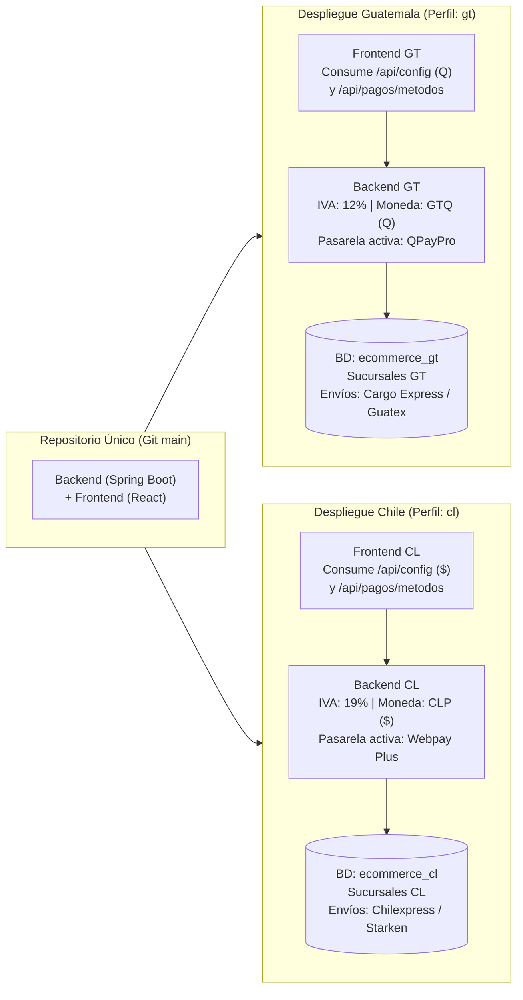
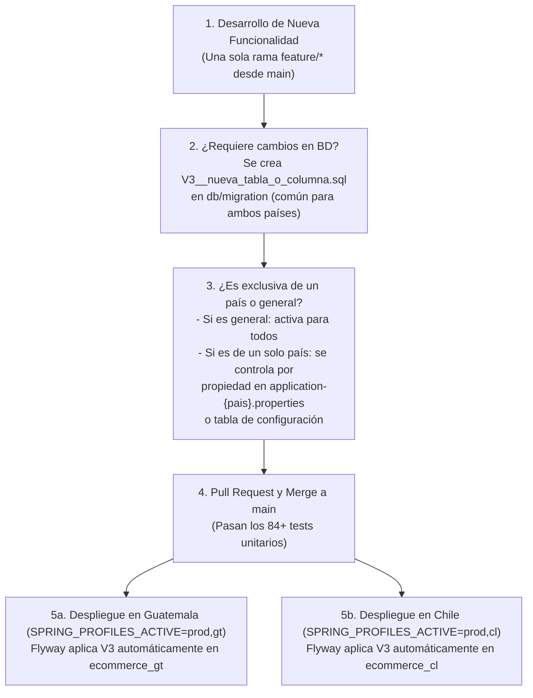
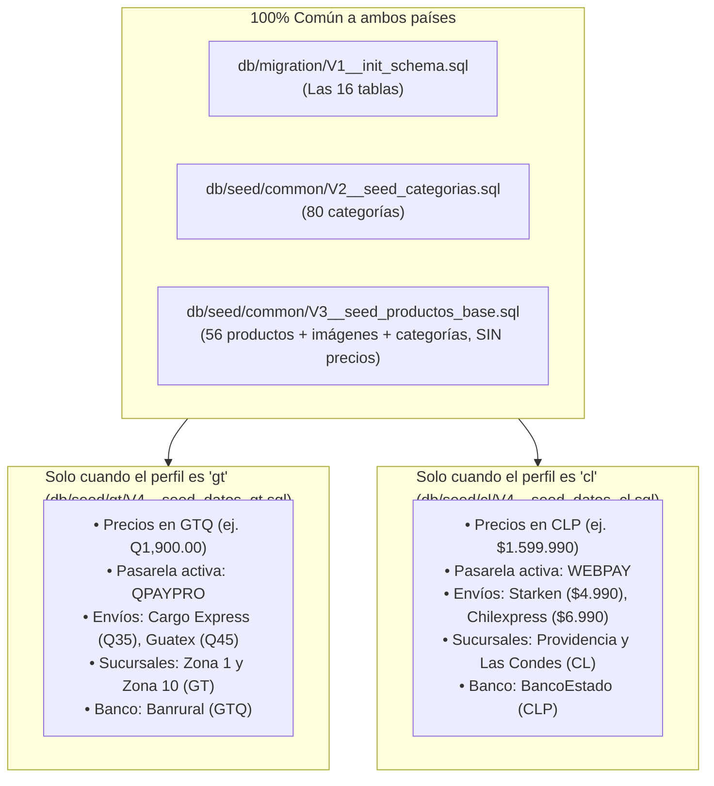

# Plan de Arquitectura Multi-País (Guatemala y Chile) y Corrección de Moneda

## 1. Diagnóstico: ¿Por qué no funciona la configuración de moneda (`api.moneda.*`) de `application-dev.properties`?

En [application-dev.properties] tienes definido correctamente:

```properties
# Moneda - Quetzal guatemalteco
api.moneda.codigo=GTQ
api.moneda.simbolo=Q
api.moneda.nombre=Quetzal
api.moneda.locale=es-GT
api.moneda.decimales=2
```

Y en el backend **sí existen** las clases que leen y exponen esta configuración:
- [`MonedaConfig`] Lee las 5 propiedades de `api.moneda.*`.
- [`ConfiguracionController`](ConfiguracionController.java#L17-L42): Expone el endpoint público `GET /api/config` devolviendo [`ConfiguracionGlobal`](ConfiguracionGlobal.java#L5-L9) (`moneda`, `montoMinimoEnvioGratis`, `storageProvider`).
- [`MonedaFormatter`](MonedaFormatter.java#L13-L30): Formatea montos usando `MonedaConfig`, pero **solo se usa en 1 lugar de todo el proyecto**: el correo de transferencia bancaria en [`EmailService.enviarDatosBancarios()`](EmailService.java#L190).

### Causa raíz por la que no se ve el símbolo `Q` en la aplicación

El **frontend nunca consulta `GET /api/config`** y tiene **5 implementaciones distintas con monedas fijas ("hardcoded")** repartidas en los componentes:

| # | Ubicación en el Frontend / BD | Qué tiene fijo actualmente | Cómo se muestra hoy |
|---|---|---|---|
| **1** | [`format.ts`](frontend/src/shared/lib/format.ts#L3-L10) (`formatCurrency`) | `new Intl.NumberFormat('es-MX', { style: 'currency', currency: 'MXN' })` | `$1,234.50` (Peso mexicano) en todo el Checkout, Resumen de Orden, Mis Pedidos y Dashboard Admin |
| **2** | [`ProductCard.tsx`](frontend/src/shared/ui/Card/ProductCard.tsx#L52) y [`AdminProductListView.tsx`](frontend/src/widgets/admin/AdminProductListView.tsx#L105) | Signo `$` concatenado manualmente: `${price}` y `${producto.precioVenta}` | `$1299` en las tarjetas del catálogo y listado de productos admin |
| **3** | [`CartDrawer.tsx`](frontend/src/widgets/cart/CartDrawer.tsx#L202-L226) y [`CartView.tsx`](ecommerce/frontend/src/widgets/cart/CartView.tsx#L49-L105) | Signo `$` fijo + `toLocaleString('es-ES', { minimumFractionDigits: 2 })` | `$1.299,00` en el carrito lateral y página de carrito |
| **4** | [`ProductDetailView.tsx`](frontend/src/widgets/product-detail/ProductDetailView.tsx#L132-L135) y [`FavoritesTab.tsx`](frontend/src/features/profile/ui/FavoritesTab/FavoritesTab.tsx#L14-L18) | `new Intl.NumberFormat('es-CL', { style: 'currency', currency: producto.moneda \|\| 'CLP' })` | `US$1.299` porque en [`V4__seed_productos_dev.sql`](resources/db/seed/V4__seed_productos_dev.sql#L415-L471) los precios se insertaron con `'USD'` |
| **5** | [`ProductForm.tsx`](frontend/src/features/admin/ui/ProductForm.tsx#L132) y [`forms.ts`](frontend/src/entities/product/model/schemas/forms.ts#L54) | Valor por defecto `moneda: 'USD'` y `<option value="USD">USD</option>` | Todo producto nuevo creado desde el panel Admin se guarda con moneda `'USD'` |

---

## 2. Mejor Práctica para Operar en Dos Países (Guatemala y Chile) con Cambios Mínimos

Existen dos patrones arquitectónicos en la industria para resolver un e-commerce multi-país:

| Criterio | Opción A (Recomendada): **Código Único + Instancia por País (`Multi-Instance / Country Profile`)** | Opción B: **Base de Datos Única Multi-Tenant (`pais_id` en todas las tablas)** |
|---|---|---|
| **Cómo funciona** | Un solo repositorio de código (Backend + Frontend). Se despliega una instancia con perfil `gt` conectada a `ecommerce_gt` (ej. `gt.tienda.com` o `tienda.com.gt`) y otra con perfil `cl` conectada a `ecommerce_cl` (ej. `cl.tienda.com` o `tienda.cl`). | Una sola base de datos donde productos, precios, stock, sucursales, envíos, bancos y órdenes tienen una columna `pais_id` (`GT` o `CL`). |
| **Modificación requerida en la app** | **Mínima (~5% del código)**: Solo centralizar la lectura de `/api/config` y `/api/pagos/metodos` que **ya existen en tu backend**. Cero cambios en el esquema de las 16 tablas. | **Muy alta (~60% del código)**: Hay que modificar casi todas las tablas SQL, entidades JPA, repositorios, servicios, filtros de catálogo y formularios admin. |
| **Aislamiento fiscal, contable y de inventario** | **Total y nativo**: El stock físico en bodegas de Guatemala no se mezcla con el de Chile; los precios en `GTQ` (con decimales) no se mezclan con `CLP` (sin decimales); IVA 12% vs 19% aislado por configuración. | Complejo: Cada consulta SQL (`SELECT`) debe filtrar por `WHERE pais = :pais` con riesgo de mostrar stock o precios de un país en el otro si se olvida un filtro. |

> [!TIP]
> **Recomendación**: La **Opción A (Código Único + Perfiles por País)** es la mejor práctica estándar cuando cada país opera con su propio inventario físico, moneda local (`GTQ` vs `CLP`), régimen de IVA distinto (`12%` vs `19%`), pasarela de pago local (`QPayPro` vs `Webpay Plus`) y paqueterías locales (`Cargo Express`/`Guatex` vs `Starken`/`Chilexpress`). Además, **tu backend ya fue diseñado pensando en este modelo** (por eso existen `MonedaConfig`, `ConfiguracionController`, `IvaCalculator` parametrizado y la tabla `metodos_pago`).



---

## 3. Qué diferencias existen entre Guatemala y Chile y cómo se parametrizan

Con la arquitectura recomendada, ninguna diferencia requiere `if (pais === 'GT')` quemado en los componentes:

| Aspecto | Guatemala (`gt`) | Chile (`cl`) | Dónde se configura |
|---|---|---|---|
| **Moneda (`codigo`, `simbolo`, `decimales`)** | `GTQ`, `Q`, `es-GT`, `2` decimales (`Q1,250.00`) | `CLP`, `$`, `es-CL`, `0` decimales (`$1.250`) | `api.moneda.*` en `application-{pais}.properties` → expuesto en `GET /api/config` |
| **Impuesto (IVA)** | `12%` (`0.12`) | `19%` (`0.19`) | `api.impuestos.iva` en `application-{pais}.properties` → usado por [`IvaCalculator`](orden/IvaCalculator.java#L12) |
| **Envío gratis desde** | Ej. `500.00` (Q500.00) | Ej. `50000` ($50.000) | `api.envio.monto-minimo-gratis` en `application-{pais}.properties` |
| **Pasarela de pago con tarjeta** | **QPayPro** (`QPAYPRO` activo, `WEBPAY` inactivo) | **Webpay Plus** (`WEBPAY` activo, `QPAYPRO` inactivo) | Tabla `metodos_pago` (`activo = true/false`) → expuesta en `GET /api/pagos/metodos` |
| **Servicios de envío** | Retiro en tienda, Cargo Express, Guatex | Retiro en tienda, Chilexpress, Starken | Tabla `servicios_envio` (administrable desde BD / panel Admin) |
| **Sucursales físicas** | Direcciones en Guatemala (`pais = 'GT'`) | Direcciones en Chile (`pais = 'CL'`) | Tabla `sucursales` (administrable desde `/api/sucursales` en el panel Admin) |
| **Cuentas bancarias** | Ej. Banrural / BI (`moneda = 'GTQ'`) | Ej. BancoEstado / Santander (`moneda = 'CLP'`) | Tabla `cuentas_bancarias` (administrable desde `/api/banco`) |

---

## 4. Cambios Mínimos Propuestos para que la App Funcione en Ambos Países

### Componente 1: Backend — Configuración Global y Perfiles por País

#### [MODIFY] [ConfiguracionGlobal.java](ecommerce/infra/config/ConfiguracionGlobal.java) y [ConfiguracionController.java](ecommerce/controller/ConfiguracionController.java)
- Incluir también `porcentajeIva` (desde `api.impuestos.iva`) y `paisCodigo` (ej. `GT` o `CL` desde `api.pais.codigo=GT`) en la respuesta de `GET /api/config`, para que el frontend conozca tanto la moneda como el código de país por defecto en formularios de dirección/sucursal y el porcentaje de IVA informativo.

#### [MODIFY] [QPayProService.java](backend/src/main/java/com/jeplabs/ecommerce/domain/pago/qpaypro/QPayProService.java)
- En la línea 68, en lugar de `String currency = "GTQ";` fijo, usar `monedaConfig.getCodigo()` (manteniendo `"GTQ"` como fallback).

#### [MODIFY] Perfiles y Semillas (`application-gt.properties` / `application-cl.properties` o perfiles de entorno)
- Mantener las migraciones estructurales (`V1__init_schema.sql`) 100% compartidas y separar o parametrizar los datos semilla por país (`db/seed/gt` vs `db/seed/cl`) o mediante scripts de inicialización por país.
- Actualizar en [`V4__seed_productos_dev.sql`](backend/src/main/resources/db/seed/V4__seed_productos_dev.sql#L415-L471) la columna `moneda` de `'USD'` a `'GTQ'` para que coincida con la moneda configurada en desarrollo.

---

### Componente 2: Frontend — Centralización de Moneda y Métodos de Pago Dinámicos

> [!IMPORTANT]
> **Nota sobre alcance**: Si decides mantener la restricción anterior de no modificar código del frontend todavía, podemos aplicar ahora solo los ajustes del backend y dejar documentado el cambio exacto del frontend, o bien aplicar también la corrección en el frontend para que veas inmediatamente el símbolo `Q` funcionando en toda la interfaz.

#### [MODIFY] [format.ts](frontend/src/shared/lib/format.ts)
- Reemplazar el `'es-MX'` / `'MXN'` fijo por una configuración reactiva/global de moneda inicializada desde `GET /api/config` al arrancar la app (con fallback configurable en variables de entorno `VITE_CURRENCY_CODE=GTQ`, `VITE_CURRENCY_SYMBOL=Q`, `VITE_CURRENCY_LOCALE=es-GT`, `VITE_CURRENCY_DECIMALS=2`).
- Respetar el número de decimales (`2` para `GTQ`, `0` para `CLP`) y el símbolo (`Q` para Guatemala, `$` para Chile):

```ts
export interface CurrencyConfig {
    codigo: string;
    simbolo: string;
    nombre: string;
    locale: string;
    decimales: number;
}

let activeCurrency: CurrencyConfig = {
    codigo: import.meta.env.VITE_CURRENCY_CODE || 'GTQ',
    simbolo: import.meta.env.VITE_CURRENCY_SYMBOL || 'Q',
    nombre: import.meta.env.VITE_CURRENCY_NAME || 'Quetzal',
    locale: import.meta.env.VITE_CURRENCY_LOCALE || 'es-GT',
    decimales: Number(import.meta.env.VITE_CURRENCY_DECIMALS ?? 2),
};

export function setCurrencyConfig(config: Partial<CurrencyConfig>): void {
    activeCurrency = { ...activeCurrency, ...config };
}

export function formatCurrency(value: number | string | null | undefined): string {
    const num = typeof value === 'number' ? value : parseFloat(String(value ?? ''));
    if (Number.isNaN(num)) return '—';
    const formattedNumber = new Intl.NumberFormat(activeCurrency.locale, {
        minimumFractionDigits: activeCurrency.decimales,
        maximumFractionDigits: activeCurrency.decimales,
    }).format(num);
    return `${activeCurrency.simbolo}${formattedNumber}`;
}
```

#### [MODIFY] Unificar los 5 lugares con formato de precio fijo para que todos llamen a `formatCurrency()`
1. [`ProductCard.tsx`](frontend/src/shared/ui/Card/ProductCard.tsx#L52): Cambiar `${price}` por `{formatCurrency(price)}`.
2. [`ProductDetailView.tsx`](frontend/src/widgets/product-detail/ProductDetailView.tsx#L132-L135): Cambiar `new Intl.NumberFormat('es-CL', ...)` por `formatCurrency(producto.precioVenta)`.
3. [`CartDrawer.tsx`](frontend/src/widgets/cart/CartDrawer.tsx#L202-L226) y [`CartView.tsx`](frontend/src/widgets/cart/CartView.tsx#L49-L105): Cambiar `$` + `toLocaleString('es-ES')` por `formatCurrency(...)`.
4. [`FavoritesTab.tsx`](frontend/src/features/profile/ui/FavoritesTab/FavoritesTab.tsx#L14-L18): Cambiar `new Intl.NumberFormat('es-CL', ...)` por `formatCurrency(item.precioVenta)`.
5. [`AdminProductListView.tsx`](frontend/src/widgets/admin/AdminProductListView.tsx#L105) y [`ProductForm.tsx`](frontend/src/features/admin/ui/ProductForm.tsx#L833-L841): Mostrar `formatCurrency(producto.precioVenta)` y permitir seleccionar `GTQ`, `CLP`, `USD` tomando como valor por defecto la moneda activa de `/api/config`.

#### [MODIFY] [PaymentStep.tsx](frontend/src/features/checkout/ui/PaymentStep/PaymentStep.tsx) y [useCheckoutLogic.ts](frontend/src/features/checkout/model/useCheckoutLogic.ts)
- Actualmente `PaymentStep.tsx` muestra **ambos botones** (`QPayPro` y `Webpay Plus`) al mismo tiempo.
- Conectándolo a `listarMetodosPago()` (`GET /api/pagos/metodos`), el checkout mostrará automáticamente solo los métodos que estén con `activo = true` en la base de datos de ese país (en Guatemala mostrará **QPayPro**, Transferencia y Contra entrega; en Chile mostrará **Webpay Plus**, Transferencia y Contra entrega).

---

## 5. ¿Cómo se trabaja en el futuro cuando se agregan nuevas funcionalidades y se debe actualizar la aplicación?

El principio de oro para mantener una aplicación en múltiples países sin duplicar esfuerzo es **Tronco Único de Código (`Single Trunk / Single Codebase`) + Configuración por Entorno**:



### Reglas prácticas para el mantenimiento futuro

1. **Nunca crear ramas separadas por país (`branch-guatemala` vs `branch-chile`)**:
   - Si creas ramas por país, cada vez que arregles un bug o agregues un módulo tendrás que hacer `cherry-pick` manual y resolver conflictos eternamente.
   - **Todo el código vive en `main`**. Tanto Guatemala como Chile ejecutan exactamente el mismo archivo compilado (`.jar` en backend y `dist/` en frontend).

2. **Cómo manejar nuevas migraciones de Base de Datos**:
   - El esquema de tablas (`db/migration/V1__init_schema.sql`, y futuras `V3__...`, `V4__...`) **siempre es idéntico en ambos países**.
   - Cuando en el futuro agregues una funcionalidad (por ejemplo, una tabla `cupones_descuento` o una columna nueva en `ordenes`), creas una nueva migración versionada en `db/migration/V3__add_cupones.sql` (o si aún estás en fase previa a producción, la integras en `V1`).
   - Al desplegar la nueva versión en el servidor de Guatemala y en el de Chile, **Flyway detecta la migración nueva y actualiza ambas bases de datos automáticamente** sin intervención manual.

3. **Cómo manejar funcionalidades futuras que solo aplican a un país**:
   - **Ejemplo real**: Ya lo tienes hoy con **FEL (Facturación Electrónica SAT)** que se invoca dentro de `QPayProService` para Guatemala, mientras que Chile usa `WebpayService`.
   - Si en el futuro agregas, por ejemplo, emisión de **Boleta Electrónica SII** para Chile o una integración con un courier chileno, se usa el **Patrón Estrategia (`Strategy Pattern`) o `Feature Flags`**:
     - Se define una propiedad en `application-gt.properties` (`api.facturacion.proveedor=FEL_GT`) y otra en `application-cl.properties` (`api.facturacion.proveedor=SII_CL`).
     - Ambas clases existen en el código fuente y están cubiertas por tests, pero en tiempo de ejecución cada país activa únicamente la suya según su archivo `.properties` o variables de entorno.

### 5.1 ¿Cómo se combinan los perfiles de País (`gt` / `cl`) con Desarrollo (`dev`) y Producción (`prod`)?

Spring Boot permite activar **perfiles compuestos** (`spring.profiles.active=dev,gt` o `prod,gt`). De esta forma **separas qué es de infraestructura (entorno) y qué es de reglas de negocio del país**:

| Archivo | Qué contiene | ¿Se usa en Dev, en Prod o en ambos? |
|---|---|---|
| `application.properties` | Configuración base común a todo el sistema (`ddl-auto=validate`, JWT defaults, `spring.profiles.active=dev,gt`). | **Ambos** (base siempre activa) |
| `application-dev.properties` | Credenciales locales de BD (`localhost:5432`), correo de pruebas, `cookie.secure=false`, sandbox de pasarelas. | **Solo Desarrollo** |
| `application-prod.properties` | Variables de entorno de servidor (`${DB_URL}`, `${DB_PASSWORD}`, `cookie.secure=true`, URLs productivas). | **Solo Producción** |
| `application-gt.properties` | Reglas de **Guatemala**: `GTQ`, símbolo `Q`, locale `es-GT`, `decimales=2`, `iva=0.12`, `monto-minimo-gratis=500.00`, `pais.codigo=GT`. | **Ambos** (`dev,gt` y `prod,gt`) |
| `application-cl.properties` | Reglas de **Chile**: `CLP`, símbolo `$`, locale `es-CL`, `decimales=0`, `iva=0.19`, `monto-minimo-gratis=50000`, `pais.codigo=CL`. | **Ambos** (`dev,cl` y `prod,cl`) |

---

## 6. ¿Qué pasa con `V4__seed_productos_dev.sql` y los datos de la BD al cambiar el perfil de `gt` a `cl`?

Esta es una distinción clave entre **lo que vive en memoria de Spring Boot (`.properties`)** y **lo que ya quedó guardado en tablas de PostgreSQL (`.sql`)**:

### 6.1 Cómo está en este momento (y por qué no cambia solo al reiniciar)

1. **Lo que SÍ cambia al instante al pasar de `dev,gt` a `dev,cl`**:
   - Las propiedades leídas por Spring Boot: `GET /api/config` pasa a devolver `CLP`, `$`, `es-CL`, `0` decimales, IVA `19%` (`0.19`) y envío gratis desde `50000`.
   - El cálculo de IVA en órdenes nuevas (`IvaCalculator` usa `0.19` en lugar de `0.12`).
   - El formateador de correos (`MonedaFormatter` formatea con `$` y sin decimales).

2. **Lo que NO cambia automáticamente solo con cambiar el perfil si la BD ya fue creada**:
   - **Flyway solo ejecuta las migraciones (`V1` a `V4`) una vez**, cuando la base de datos está vacía.
   - Si ya levantaste la app con `dev,gt`, PostgreSQL ya guardó en el disco duro las filas de `precio_historial` con `'GTQ'` y montos como `1900.00`, las sucursales de Guatemala y los envíos `Cargo Express` / `Guatex`.
   - Además, como actualmente `V4__seed_productos_dev.sql` tiene escrito literalmente `'GTQ'` en el archivo SQL, aunque borraras la BD y arrancaras con `dev,cl`, volvería a insertar `'GTQ'`.

---

### 6.2 Las 2 formas de hacer que Flyway cargue los precios y datos de Chile automáticamente

Dependiendo de qué necesites al cambiar a `cl`, podemos implementar una de estas dos opciones en el backend:

#### Alternativa A: Solo cambiar el código `'GTQ'` ↔ `'CLP'` con Placeholders de Flyway (Mismos números)
Si solo quieres que el texto `'GTQ'` cambie a `'CLP'` automáticamente según el perfil (manteniendo los mismos números `1900.00`, `999.00`, etc.):
- En `application-gt.properties` se agrega: `spring.flyway.placeholders.moneda_codigo=GTQ`
- En `application-cl.properties` se agrega: `spring.flyway.placeholders.moneda_codigo=CLP`
- En `V4__seed_productos_dev.sql` se reemplaza `'GTQ'` por `'${moneda_codigo}'`.
- **Desventaja**: En Chile `$1.900 CLP` equivalen a ~2 dólares (una laptop en Chile cuesta `1.599.990 CLP`, no `1.900 CLP`), y las sucursales/paqueterías seguirían siendo las de Guatemala.

#### Alternativa B (Recomendada): Carpetas de Semillas por País (`db/seed/gt` y `db/seed/cl`)
Es la práctica estándar cuando quieres que al levantar con `gt` se carguen datos, precios, sucursales y pasarela de Guatemala, y al levantar con `cl` se carguen datos, precios en pesos chilenos, sucursales de Santiago y Webpay Plus:



> [!IMPORTANT]
> **¿Por qué hay que tener en cuenta la Base de Datos al cambiar de `dev,gt` a `dev,cl`?**
> Una base de datos PostgreSQL que ya tiene insertados datos de Guatemala no se sobrescribe sola al reiniciar Spring Boot porque Flyway nunca borra tablas existentes. Tienes dos formas de trabajar localmente:
> 1. **Dos bases de datos locales en PostgreSQL (`ecommerce_gt` y `ecommerce_cl`)**: `application-gt.properties` apunta a `ecommerce_gt` y `application-cl.properties` apunta a `ecommerce_cl`. Así puedes cambiar entre `dev,gt` y `dev,cl` cuantas veces quieras sin borrar nada ni tener conflictos de checksum en Flyway.
> 2. **Una sola base de datos local (`ecommerce-ea`)**: Cuando quieras cambiar de Guatemala a Chile en la misma BD, ejecutas `DROP SCHEMA public CASCADE; CREATE SCHEMA public;` y al arrancar con `dev,cl`, Flyway poblará todo con los datos y precios de Chile.

---

## 7. Decisión para Ajustar las Semillas Multi-País

> [!IMPORTANT]
> Dime cuál de estas opciones prefieres que configuremos para las semillas SQL:
> 1. **Implementar la Alternativa B (`db/seed/common` + `db/seed/gt` + `db/seed/cl`)**: Para que cuando inicialices una BD con `dev,gt` cargue precios en `GTQ`, sucursales/envíos de Guatemala y QPayPro, y cuando inicialices con `dev,cl` cargue automáticamente precios en `CLP`, sucursales/envíos de Chile y Webpay Plus.
> 2. **Implementar la Alternativa A (Placeholder `${moneda_codigo}` en el mismo `V4`)**: Mantener los mismos archivos actuales y solo usar una variable `${moneda_codigo}` para que inserte `'GTQ'` o `'CLP'`.
> 3. **Dejarlo como está ahora** (`V2` y `V4` con datos de Guatemala por defecto, y usar el script SQL manual cuando se requiera pasar una BD a Chile).
