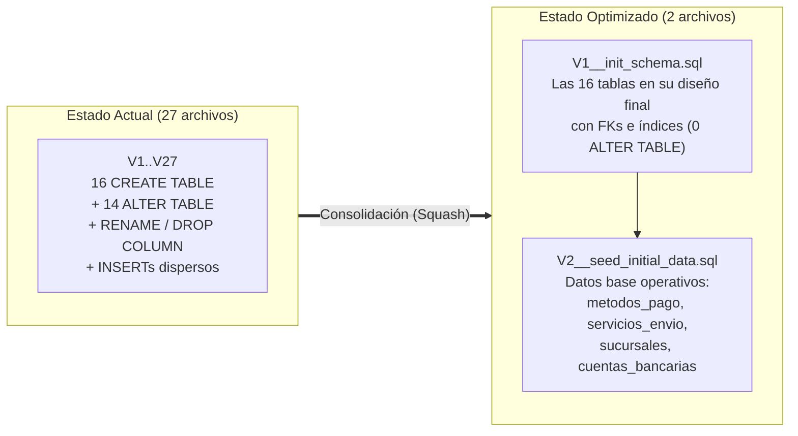

# Plan de Implementación: Optimización de Migraciones Flyway y Estrategia de Datos Semilla

> [!NOTE]
> Este documento corresponde a la **Fase 2** de la conversación. El plan original de la **Fase 1 (Tabla `sucursales` y Retiro en Tienda)** se conserva íntegro en [implementation_plan.md](implementation_plan.md).

## 1. Diagnóstico de las 27 Migraciones Actuales (`V1` a `V27`)

Al analizar el historial completo en `backend/src/main/resources/db/migration/`, se observa que el esquema creció orgánicamente a lo largo de **27 archivos**, acumulando múltiples operaciones redundantes que hoy ralentizan y ensucian la creación desde cero:

| Tabla | Migraciones que la tocan | Redundancias / Parches históricos detectados |
|---|---|---|
| `usuarios` | `V1`, `V2`, `V3`, `V4` | Se crea en `V1` y sufre 3 `ALTER TABLE` seguidos para agregar `apellido`, `pais`, `intentos_fallidos`, `bloqueado` y `ultimo_intento_fallido`. |
| `productos` | `V5`, `V6`, `V8`, `V22` | Se crea con columna `active` en `V5`; en `V6` se hace `DROP COLUMN active` y se agrega `estado`; en `V8` se agrega `version INTEGER`; en `V22` se intenta agregar `IF NOT EXISTS version BIGINT` (que no tuvo efecto porque ya existía como `INTEGER`, el cual es el tipo que exige `Producto.java` con `@Version private Integer version`). |
| `carritos` | `V8`, `V9` | Se crea en `V8` y en `V9` se altera para agregar `expira_at` y `notificacion_enviada`. |
| `ordenes` | `V10`, `V11`, `V14`, `V15`, `V16`, `V17`, `V19`, `V27` | **8 migraciones distintas** modifican `ordenes`: se agrega `forma_pago` en `V11` y se renombra a `forma_pago_envio` en `V17`; se agrega `metodo_pago VARCHAR(30)` en `V14`, se hace un `UPDATE` en `V15`, se cambia a `VARCHAR(50)` en `V16`; se agrega `nota_envio` en `V19` y `sucursal_id` + `sucursal_horario` en `V27`. |
| `servicios_envio` | `V11`, `V12`, `V18`, `V20`, `V27` | **5 migraciones distintas**: se inserta data en `V11` y `V12`, se agrega `servicio_express` en `V18`, se renombra a `sin_contra_entrega` en `V20`, y se agrega `retiro_tienda` con un `UPDATE` en `V27`. |
| `metodos_pago` | `V16`, `V25` | Se crea e inserta data en `V16`, y en `V25` se inserta `QPAYPRO`. |
| Resto de tablas | `V5`, `V7`, `V13`, `V14`, `V21`, `V23`, `V24`, `V26`, `V27` | `categorias`, `precio_historial`, `producto_categorias`, `producto_imagenes`, `direcciones`, `password_reset_tokens`, `cuentas_bancarias`, `webpay_transacciones`, `favoritos`, `qpaypro_transacciones`, `refresh_tokens`, `sucursales`. |

---

## 2. Buena Práctica: ¿Datos desde Migraciones en la App o desde Scripts en la Base de Datos?

En ingeniería de software con **Spring Boot + Flyway**, la regla de oro consiste en **separar los datos según su naturaleza en 2 categorías**:

### Categoría A: Datos Operativos / Configuración Base del Sistema (*Reference & System Seed Data*)
Son los registros sin los cuales la aplicación **no puede operar o el flujo de negocio se rompe** (por ejemplo: los códigos de `metodos_pago` que el frontend y backend esperan como `'STRIPE'`, `'WEBPAY'`, `'QPAYPRO'`, `'TRANSFERENCIA'`, `'CONTRA_ENTREGA'`; los `servicios_envio` base como `'Retiro en tienda'`; las `sucursales` iniciales y `cuentas_bancarias`).

- **Buena práctica**: **SÍ deben ir dentro de una migración de Flyway en la app** (por ejemplo, `V2__seed_initial_data.sql`), pero **separada de la migración de creación de tablas (`V1__init_schema.sql`)** y usando siempre cláusulas idempotentes (`ON CONFLICT DO NOTHING`).
- **¿Por qué?**: Garantiza que cualquier entorno nuevo (un desarrollador nuevo, un contenedor Docker, pruebas de integración o el despliegue inicial en producción) funcione al 100% apenas arranca la aplicación, sin pasos manuales olvidados.

### Categoría B: Datos de Catálogo Masivo o de Prueba (*Catalog & Demo Data*)
Son datos voluminosos o cambiantes del negocio (como tus archivos `categoriasInput.sql` con 70 categorías y `productosCatalogo.sql` con cientos de productos, precios e imágenes).

- **Buena práctica**: **NO deben ir en las migraciones principales (`db/migration/V*`)** que corren en todos los entornos.
- **¿Cómo se deben manejar entonces? Tienes 2 opciones estándar**:
  1. **Opción 1 — Scripts externos / Carga manual en BD (Lo que tienes hoy en `src/main/resources/*.sql`)**:
     - Mantener `categoriasInput.sql` y `productosCatalogo.sql` fuera de `db/migration` (por ejemplo, en `backend/db/scripts/` o `src/main/resources/`) para ejecutarlos bajo demanda desde pgAdmin / DBeaver / `psql` cuando quieras poblar una base de datos vacía.
     - **Ventaja**: Arranque ultrarrápido de la app y control total sobre cuándo poblar el catálogo.
  2. **Opción 2 — Migraciones exclusivas por perfil de entorno (`db/seed` solo en `dev`)**:
     - Flyway permite configurar en `application.properties` (`prod`):
       `spring.flyway.locations=classpath:db/migration`
       Y en `application-dev.properties` (`dev`):
       `spring.flyway.locations=classpath:db/migration,classpath:db/seed`
     - Colocando el catálogo en `db/seed/V3__seed_catalogo_dev.sql` (o repetible `R__seed_catalogo_dev.sql`), en desarrollo se carga solo al recrear la BD, pero jamás contamina producción.

---

## 3. Cómo Optimizar las Migraciones ("Migration Squashing")

La técnica estándar de la industria para limpiar un historial largo antes de salir a producción (o al reiniciar el entorno base) se llama **Migration Squashing** (consolidación de migraciones).

Consiste en reemplazar las **27 migraciones (`V1`..`V27`)** por únicamente **2 archivos limpios**:



> [!WARNING]
> **Importante sobre `flyway_schema_history` al consolidar migraciones:**
> Flyway guarda en la tabla `flyway_schema_history` de PostgreSQL un hash (*checksum*) de cada archivo `V1..V27` que ya se ejecutó.
> Si reemplazamos `V1..V27` por los nuevos `V1` y `V2`, en una base de datos que ya tenía las 27 migraciones aplicadas debes recrear el esquema (`DROP SCHEMA public CASCADE; CREATE SCHEMA public;` o recrear la base de datos) antes de iniciar el backend, para que Flyway construya todo limpio desde cero con los nuevos `V1` y `V2`.

---

## User Review Required

> [!IMPORTANT]
> **Decisiones para que me confirmes antes de aplicar el cambio:**
> 1. **Estructura de archivos en `db/migration`**: ¿Estás de acuerdo en consolidar las 27 migraciones en **2 archivos** (`V1__init_schema.sql` solo para las 16 tablas/índices y `V2__seed_initial_data.sql` para los datos operativos base: métodos de pago, servicios de envío, sucursales y cuenta bancaria), o prefieres **1 solo archivo** (`V1__init_schema.sql` solo tablas y mover incluso los datos operativos a un script externo)?
> 2. **Servicios de envío en los datos semilla (`servicios_envio`)**: En `V11` se insertaron `'Guatex'` y `'Cargo Express'` (Guatemala), y luego en `V12` se insertaron `'Chilexpress'`, `'Starken'` y `'Retiro en tienda'`. ¿Quieres conservar los 5 en la semilla inicial, o dejar únicamente los que usas actualmente (por ejemplo, `'Guatex'`, `'Cargo Express'` y `'Retiro en tienda'`)?
> 3. **Scripts de catálogo (`categoriasInput.sql` y `productosCatalogo.sql`)**: ¿Prefieres mantenerlos como scripts manuales separados (fuera de `db/migration`), o quieres que los configuremos en una carpeta `db/seed` para que Flyway los cargue automáticamente cuando estés en el perfil `dev`?

---

## 4. Proposed Changes

### Consolidación de Migraciones en `backend/src/main/resources/db/migration`

#### [DELETE] Eliminar las 27 migraciones fragmentadas (`V1` a `V27`)
- `V1__create_usuarios.sql` hasta `V27__create_sucursales.sql`.

---

#### [NEW] `backend/src/main/resources/db/migration/V1__init_schema.sql`
Creación directa y limpia (sin un solo `ALTER TABLE`) de las **16 tablas** del sistema en orden estricto de dependencias de claves foráneas, respetando al 100% la validación de Hibernate (`spring.jpa.hibernate.ddl-auto=validate`):

1. **Seguridad y Usuarios**:
   - `usuarios` (con `apellido`, `pais`, `intentos_fallidos`, `bloqueado`, `ultimo_intento_fallido`).
   - `password_reset_tokens` (FK a `usuarios`).
   - `refresh_tokens` (FK a `usuarios` + sus 3 índices: `idx_refresh_tokens_usuario_id`, `idx_refresh_tokens_family_id`, `idx_refresh_tokens_expira_at`).
2. **Catálogo y Favoritos**:
   - `categorias` (auto-referencia `parent_id`).
   - `productos` (con `estado VARCHAR(20)`, `version INTEGER`, `specs JSONB`, sin la antigua columna `active`).
   - `precio_historial` (FK a `productos`).
   - `producto_categorias` (PK compuesta `producto_id, categoria_id`).
   - `producto_imagenes` (FK a `productos`).
   - `favoritos` (PK compuesta `usuario_id, producto_id` con `ON DELETE CASCADE`).
3. **Ubicaciones, Envíos y Pagos Configurables**:
   - `direcciones` (FK a `usuarios`).
   - `sucursales` (tabla completa de tiendas físicas).
   - `servicios_envio` (con `sin_contra_entrega` y `retiro_tienda` desde su creación).
   - `cuentas_bancarias` (cuentas para transferencia).
   - `metodos_pago` (catálogo de métodos de pago con `configuracion JSONB`).
4. **Carrito, Órdenes y Transacciones de Pasarelas**:
   - `carritos` (con `expira_at` y `notificacion_enviada`).
   - `carrito_items` (con `UNIQUE(carrito_id, producto_id)`).
   - `ordenes` (con `direccion_id`, `sucursal_id`, `servicio_envio_id`, `forma_pago_envio`, `costo_envio`, `metodo_pago VARCHAR(50)`, `comprobante_*`, `nota_envio`, `direccion_*` snapshot y `sucursal_horario`).
   - `orden_items` (FK a `ordenes` y `productos`).
   - `webpay_transacciones` (FK a `ordenes`).
   - `qpaypro_transacciones` (FK a `ordenes` con `ON DELETE CASCADE`).

---

#### [NEW] `backend/src/main/resources/db/migration/V2__seed_initial_data.sql`
Inserción limpia y ordenada de la configuración operativa mínima para que el checkout funcione de inmediato al crear la base de datos:
- `metodos_pago`: `STRIPE`, `MERCADO_PAGO`, `WEBPAY`, `TRANSFERENCIA`, `CONTRA_ENTREGA`, `QPAYPRO` (con `ON CONFLICT (codigo) DO NOTHING`).
- `servicios_envio`: Servicios de entrega y `Retiro en tienda` (ya con sus flags `sin_contra_entrega` y `retiro_tienda` correctos desde el `INSERT`, sin necesidad de `UPDATE` posterior).
- `sucursales`: `Tienda Centro` y `Tienda Zona 10`.
- `cuentas_bancarias`: Cuenta inicial de ejemplo (`Banrural`).

---

## 5. Verification Plan

### Automated Tests
1. Ejecutar la suite de pruebas del backend:
   ```powershell
   cd backend
   .\mvnw.cmd test
   ```

### Manual Verification (Al recrear tu BD local)
1. En PostgreSQL local, limpiar el esquema actual:
   ```sql
   DROP SCHEMA public CASCADE;
   CREATE SCHEMA public;
   ```
2. Iniciar la aplicación Spring Boot (`.\mvnw.cmd spring-boot:run`).
3. Verificar en los logs de arranque que Flyway aplica únicamente `V1__init_schema.sql` y `V2__seed_initial_data.sql`, y que Hibernate completa la validación (`SchemaValidator`) exitosamente.
