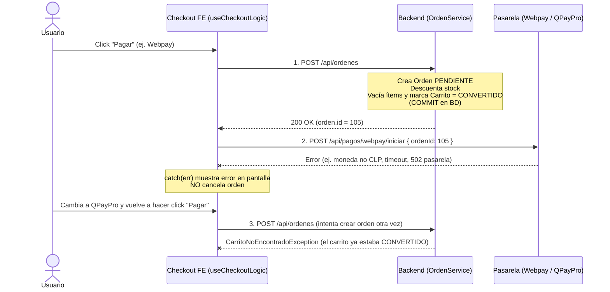

# Diagnóstico Técnico: Carrito Vacío y Orden `PENDIENTE` Huérfana al Fallar la Iniciación de Pasarela

> **Documento de Análisis Arquitectónico — Checkout & Órdenes**  
> **Fecha:** Noviembre 2026  
> **Estado:** Diagnóstico documentado (pendiente de decisión e implementación)

---

## 1. Incidente Observado

Durante pruebas en el entorno configurado para **Guatemala (`GTQ`)**:
1. En el paso de pago (`/checkout`), se seleccionó **Webpay Plus** (pasarela chilena) y se intentó confirmar el pedido.
2. Webpay rechazó la transacción por incompatibilidad de moneda/formato (Transbank opera exclusivamente en pesos chilenos `CLP` enteros).
3. Sin recargar ni salir del checkout, se cambió el método de pago a **QPayPro** y se volvió a presionar pagar.
4. El sistema devolvió un error indicando que **no existe carrito activo**, impidiendo completar la compra.

### Conclusión inmediata y alcance real
Aunque el disparador puntual fue no ocultar Webpay Plus en el perfil de Guatemala, este episodio dejó en evidencia un **caso borde estructural más amplio**:

> **Cualquier fallo en la comunicación con una pasarela externa durante `iniciar` (caída de red, timeout, error 5xx de Transbank/QPayPro, credenciales inválidas o error de moneda)** ocurre **después** de haber convertido el carrito en una orden en base de datos, dejando al usuario bloqueado en `/checkout` sin carrito activo y con una orden `PENDIENTE` huérfana reteniendo stock.

---

## 2. Trazado Exacto del Flujo Actual (Frontend + Backend)

En [`useCheckoutLogic.ts`](../src/features/checkout/hooks/useCheckoutLogic.ts#L397-L437), `completeCheckout()` ejecuta dos transacciones HTTP independientes y secuenciales:

### Puntos exactos en el código actual
1. **Conversión irreversible del carrito en el Paso 1:**  
   En [`OrdenService.crear`](../../backend/src/main/java/com/jeplabs/ecommerce/domain/orden/OrdenService.java#L95-L225):
   - Descuenta `stock` de cada producto (línea 203).
   - Elimina `CarritoItem`s (`carritoItemRepositorio.deleteAll(...)`), limpia `carrito.getItems().clear()` y ejecuta `carrito.marcarComoConvertido()` (líneas 222–224).
   - Al terminar el método `@Transactional`, esa operación queda confirmada definitivamente en PostgreSQL.
2. **Fallo posterior en el Paso 2 (`iniciarWebpay` / `iniciarQPayPro`):**  
   En [`WebpayService.iniciar`](../../backend/src/main/java/com/jeplabs/ecommerce/domain/pago/webpay/WebpayService.java#L38-L96) y [`QPayProService.iniciarPago`](../../backend/src/main/java/com/jeplabs/ecommerce/domain/pago/qpaypro/QPayProService.java), la llamada externa ocurre en una segunda petición HTTP separada. Si lanza excepción, la Orden `#105` **ya existe en estado `PENDIENTE`** y sigue reteniendo inventario hasta que el usuario la cancele manualmente en `/profile/ordenes` o expire por [`OrdenExpiracionScheduler`](../../backend/src/main/java/com/jeplabs/ecommerce/domain/orden/scheduler/OrdenExpiracionScheduler.java).
3. **Segundo intento fallido desde `/checkout`:**  
   Al pulsar nuevamente el botón de pago en `/checkout`, `useCheckoutLogic.ts` vuelve a llamar a `orderApi.crearOrden(...)` en lugar de operar sobre la orden ya creada. [`OrdenService.crear`](../../backend/src/main/java/com/jeplabs/ecommerce/domain/orden/OrdenService.java#L99-L101) exige `EstadoCarrito.ACTIVO` y lanza `CarritoNoEncontradoException`.
4. **Escenario hermano con `x_url_cancel` en QPayPro:**  
   Como se documentó también en [`Propuesta-Polling-QPayPro-Checkout.md`](./Propuesta-Polling-QPayPro-Checkout.md), `QPayProService.java` (línea 204) envía `x_url_cancel = frontendUrlBase + "/checkout"`. Si el usuario pulsa "Cancelar" dentro de QPayPro, regresa a `/checkout` exactamente en la misma situación: carrito vacío/convertido y orden `PENDIENTE` sin gestión directa en esa pantalla.

---

## 3. Causas Raíz Identificadas

| # | Capa | Causa |
| :--- | :--- | :--- |
| **1** | **Frontend (`PaymentStep.tsx`)** | [`PaymentStep.tsx`](../src/features/checkout/components/PaymentStep/PaymentStep.tsx#L60-L103) renderiza **siempre** QPayPro (Guatemala) y Webpay Plus (Chile) a la vez, sin filtrar por `isGuatemala` / `isChile` ni por código de moneda de [`ConfigProvider`](../src/app/providers/ConfigProvider.tsx#L32-L33). |
| **2** | **Frontend + Backend (`useCheckoutLogic` / `OrdenService`)** | Falta de atomicidad o compensación entre `crearOrden` y el inicio de pago en pasarela externa: si falla `iniciarPasarela`, el sistema ni hace rollback/cancelación automática de la orden ni permite reutilizar esa orden `PENDIENTE` desde `/checkout`. |
| **3** | **Frontend (`useCheckoutLogic` `catch`)** | Ante errores de pasarela tras `crearOrden`, no se ejecuta `refreshCart()` ni se informa al usuario que su pedido quedó en `/profile/ordenes` pendiente de pago. |

---

## 4. Evaluación: ¿Conviene modificar el sistema actual?

**Sí, vale la pena atenderlo**, separando la solución inmediata (muy simple) de la mejora estructural (según cuánto se quiera blindar la experiencia de pago):

### Nivel 1 — Corrección Inmediata (Bajo esfuerzo, elimina el error por moneda)
- Filtrar métodos de pago visibles en [`PaymentStep.tsx`](../src/features/checkout/components/PaymentStep/PaymentStep.tsx) usando `useConfig()` (`isChile` ➔ habilitar Webpay Plus; `isGuatemala` ➔ habilitar QPayPro; Transferencia y Contra entrega disponibles según reglas vigentes).
- *(Opcional en backend)*: Validar en `WebpayService.iniciar` que `monedaConfig.getCodigo()` sea `'CLP'` y en `QPayProService.iniciarPago` que corresponda a `'GTQ'`/`'USD'`, rechazando antes de tocar la pasarela si no coincide.

### Nivel 2 — Blindaje ante fallos de conexión con la pasarela (Recomendado evaluar)
Existen **tres estrategias** para que un fallo al iniciar Webpay o QPayPro nunca deje al cliente atrapado sin carrito:

#### Alternativa A — Reintentar / Recuperar sobre la Orden `PENDIENTE` en Checkout (Mejor UX sin perder reserva de stock)
1. En `useCheckoutLogic.ts`, tras recibir `orden` de `orderApi.crearOrden(...)`, guardar temporalmente `pendingOrderRef.current = orden` (en estado del hook / `sessionStorage`).
2. Si `iniciarWebpay` / `iniciarQPayPro` falla:
   - Mostrar un banner/alerta clara: *"Tu pedido #105 quedó registrado, pero no pudimos conectar con la pasarela."*
   - Si el usuario vuelve a presionar Pagar con el mismo método (reintento de red), **no llamar de nuevo a `POST /api/ordenes`**, sino invocar directamente `iniciarWebpay({ ordenId: 105 })` o `iniciarQPayPro({ ordenId: 105 })`.
   - Adicionalmente, ofrecer acción explícita de *"Cancelar pedido #105"* (llamando a `orderApi.cancelarOrden(105)`) o enlace directo a `/profile/ordenes`.
3. **Nota importante si cambia de método:** Si la orden se creó con `metodoPagoCodigo = 'WEBPAY'`, en el backend `Orden` guarda un solo `metodoPagoCodigo`; cambiar a otro método en la misma orden requeriría permitir actualizar `metodoPago` de una orden `PENDIENTE` sin transacciones aprobadas, o cancelar la orden anterior y permitir rehacer el carrito.

#### Alternativa B — Compensación automática si falla la primera iniciación de pasarela
- Si `iniciarWebpay` o `iniciarQPayPro` falla en el backend (o inmediatamente desde el `catch` del frontend antes de haber emitido token de pago):
  - **En Backend** (endpoint compuesto `POST /api/pagos/checkout-pasarela` o compensación transaccional): si `pasarela.create(...)` falla antes de emitir token/URL, se revierte el descuento de stock y **no se convierte el carrito** (o se cancela la orden en el acto y se restaura el carrito activo).
  - **Ventaja:** El usuario permanece en `/checkout` con su carrito intacto y puede elegir otro método o reintentar transparentemente, como si nada se hubiera roto.
  - **Desventaja / Precaución:** La llamada a una API externa (Transbank/QPayPro) dentro de una `@Transactional` de base de datos retiene la conexión JDBC mientras espera respuesta HTTP externa; por eso suele preferirse el patrón *Outbox / Compensación explícita fuera de la transacción de BD* o la **Alternativa A**.

#### Alternativa C — Mínimo viable informativo (Sin cambios en backend)
- En el `catch` de `useCheckoutLogic.ts`, si `crearOrden` ya se ejecutó antes de la excepción:
  - Llamar a `await refreshCart()` (para sincronizar el estado real del carrito en el header/contexto).
  - Redirigir o mostrar aviso directo con enlace a **Mis Órdenes (`/profile/ordenes`)** indicando que el pedido quedó `PENDIENTE` (de forma análoga a cuando ocurre un error en recuperación), evitando que el usuario pulse "Pagar" por segunda vez contra un carrito vacío.

---

## 5. Checklist de Recomendación

1. **Corto plazo:** Aplicar el **Nivel 1** en `PaymentStep.tsx` (ocultar Webpay en perfil `GT` y QPayPro en perfil `CL` usando `useConfig()`) + **Alternativa C** (guardar referencia si `crearOrden` ya ocurrió para informar / no dejar re-disparar `POST /api/ordenes` a ciegas).
2. **Mediano plazo:** Evaluar si se prefiere **Alternativa B** (no convertir/vaciar el carrito hasta que la pasarela devuelva su URL de redirección válida, restaurando stock automáticamente ante fallo de conexión) o **Alternativa A** (pantalla de recuperación de orden `PENDIENTE` directamente en `/checkout` con reintento y cancelación explícita).
