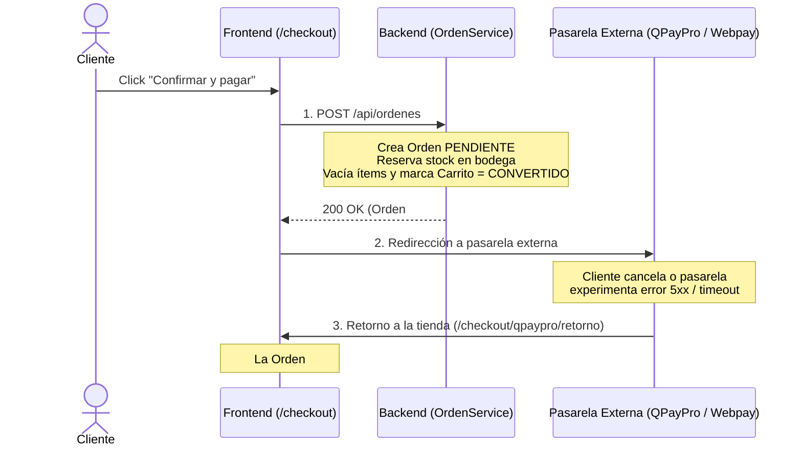
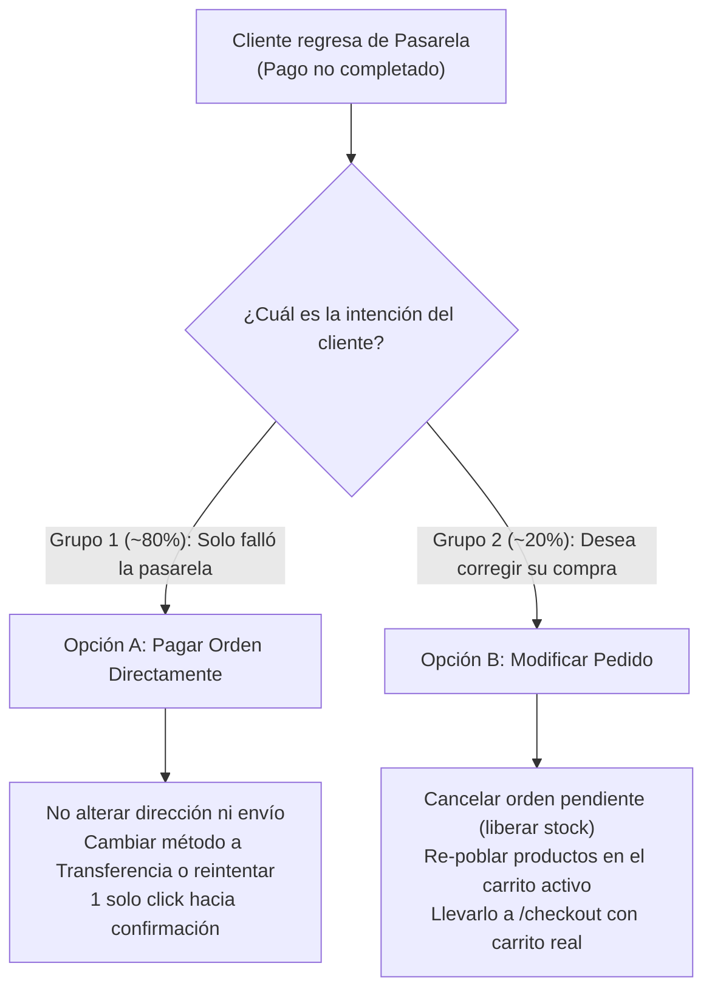

# Estrategia Arquitectónica de Recuperación ante Fallos o Cancelaciones en Pasarelas Externas

> **Audiencia:** Equipo de Ingeniería Frontend y Arquitectura  
> **Fecha:** Noviembre 2026  
> **Contexto:** Dominio de Checkout, Órdenes y Pasarelas de Pago (Webpay Plus y QPayPro)  
> **Estado:** Documentación aprobada para implementación

---

## 1. El Problema Estructural

En el flujo de compra con pasarelas externas (Webpay Plus en Chile, QPayPro en Guatemala):



### ¿Por qué fallaba el retorno a `/checkout`?
Si el usuario pulsa *"Volver al checkout"* desde la pantalla de retorno:
1. `/checkout` está diseñado para procesar **carritos activos**, no para gestionar órdenes ya creadas.
2. Como el backend convirtió y vació el carrito al crear la orden #105, el frontend detecta `isEmpty === true` (carrito vacío).
3. La guarda automática expulsa al usuario hacia `/cart`, mostrándole *"No tienes productos en el carrito"*.
4. Si se intentara forzar a `/checkout` a cargar esa orden congelada, se generaría un conflicto de negocio: el usuario no puede cambiar su dirección ni su costo de envío porque la orden ya fue emitida en la base de datos y su inventario fue reservado.

---

## 2. Las Dos Intenciones del Cliente (Análisis de UX)

Cuando un cliente regresa de una pasarela con un pago no completado, sus intenciones se dividen en dos grupos:



---

## 3. La Solución Arquitectónica Combinada (Estándar de la Industria)

La mejor práctica (adoptada por plataformas líderes como Shopify y Mercado Libre) consiste en **resolver ambas necesidades directamente en la pantalla de retorno**, sin forzar parches artificiales en `/checkout`.

### Flujo A: Pagar la Orden Existente con Otro Método (Sin rehacer el checkout)
Para el cliente que solo quiere completar su pago:
1. En la pantalla de retorno ([`QPayProReturn.tsx`](../src/features/checkout/components/QPayProReturn/QPayProReturn.tsx)), se presentan los métodos alternativos viables (ej. **Transferencia bancaria**).
2. Al seleccionar *"Pagar por transferencia"*:
   - Invoca el endpoint `PATCH /api/ordenes/{id}/metodo-pago` (`orderApi.actualizarMetodoPago`).
   - Marca la orden como transferencia en almacenamiento local (`markOrderAsBankTransfer`).
   - Limpia el identificador pendiente de `sessionStorage`.
   - Navega inmediatamente a `/checkout/success` con los datos de las cuentas bancarias para transferir.
3. **Resultado:** En 5 segundos el cliente tiene su compra confirmada sin tener que volver a ingresar direcciones ni envíos.

### Flujo B: Modificar Pedido y Volver al Checkout (Restaurando el carrito)
Para el cliente que desea cambiar su dirección, cambiar el tipo de envío o ajustar productos:
1. En la pantalla de retorno, el botón *"Modificar pedido / Volver al checkout"* ejecuta una función de restauración limpia:
   ```ts
   // 1. Cancela la orden pendiente en backend (libera el stock reservado)
   await orderApi.cancelarOrden(orden.id);

   // 2. Vuelve a agregar los ítems al carrito activo
   for (const item of orden.items) {
       await cartApi.addToCart(item.productoId, item.cantidad);
   }

   // 3. Limpia la orden pendiente de sessionStorage
   limpiarOrdenQPayProPendiente();

   // 4. Sincroniza el carrito en el contexto global
   await refreshCart();

   // 5. Navega a /checkout
   navigate('/checkout');
   ```
2. **Resultado:** El usuario llega a `/checkout` con **su carrito real cargado**, las direcciones operativas, el cálculo de envío disponible y puede modificar cualquier dato con total naturalidad.

---

## 4. Beneficios Arquitectónicos

1. **Separación de Responsabilidades:**  
   - `/checkout` se mantiene simple, enfocado exclusivamente en transformar carritos activos en órdenes.
   - Las pantallas de retorno (`/checkout/qpaypro/retorno` y `/checkout/webpay/retorno`) asumen la gestión del incidente de pago.
2. **Cero Parches Frágiles en `useCheckoutLogic`:**  
   No se requiere falsear el estado de `isEmpty`, ni ocultar el carrito en el resumen lateral, ni bloquear condicionalmente la navegación.
3. **Inventario Seguro:**  
   El stock nunca queda retenido indefinidamente en órdenes huérfanas: si el cliente decide rehacer su pedido, la orden previa se cancela explícitamente y el stock vuelve a bodega antes de re-poblar el carrito.
4. **Cero Cambios en el Backend:**  
   Esta solución utiliza 100% los contratos que el backend ya tiene operativos:
   - `PATCH /api/ordenes/{id}/cancelar` (cancela y devuelve stock).
   - `PATCH /api/ordenes/{id}/metodo-pago` (actualiza pasarela/transferencia).
   - `POST /api/carrito/items` (agrega productos al carrito).
