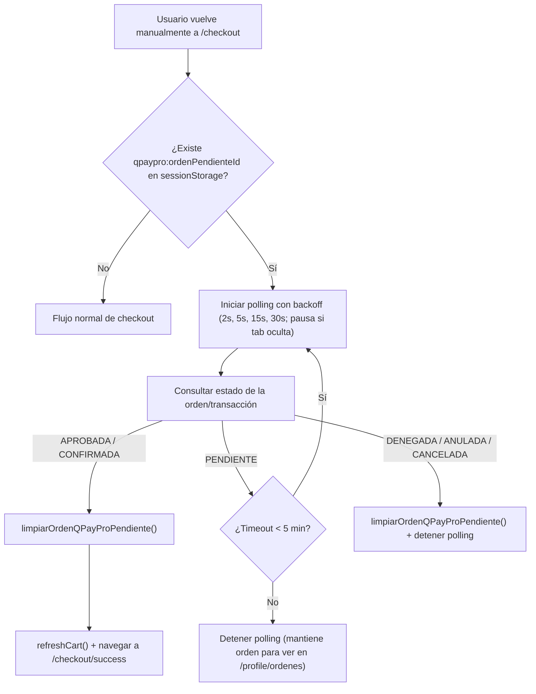

# Propuesta Técnica: Polling y Recuperación de Órdenes Pendientes para QPayPro en Checkout

> **Documento de Arquitectura y Evolución — Checkout (Guatemala / QPayPro)**  
> **Fecha:** Noviembre 2026  
> **Estado:** Evaluación / Propuesta de mejora (no requerida para el flujo base actual)

---

## 1. Contexto Actual: Diferencia entre Webpay Plus (CL) y QPayPro (GT)

Actualmente, las dos pasarelas reales con redirección externa tienen comportamientos asimétricos cuando el cliente vuelve manualmente a `/checkout`:

| Capacidad | Webpay Plus (Chile) | QPayPro (Guatemala) |
| :--- | :--- | :--- |
| **Persistencia en `sessionStorage` al redirigir** | ✅ `guardarOrdenWebpayPendiente(orden.id)` en `useCheckoutLogic.ts` | ✅ `guardarOrdenQPayProPendiente(orden.id)` en `useCheckoutLogic.ts` |
| **Consumo en vista de retorno dedicado** | ✅ `CheckoutReturn.tsx` (`/checkout/retorno`) | ✅ `QPayProReturn.tsx` (`/checkout/qpaypro/retorno`) |
| **Polling automático en `/checkout` (Caso 5)** | ✅ `useEffect` en `useCheckoutLogic.ts` con `consultarEstadoWebpay` | ❌ No implementado en `useCheckoutLogic.ts` |
| **Endpoint de estado en Backend** | ✅ `GET /api/pagos/webpay/estado/{ordenId}` | ❌ No implementado aún en `QPayProController.java` |
| **Cliente y Schema en Frontend** | ✅ `consultarEstadoWebpay` + `webpayEstadoSchema` | ✅ Preparado en `paymentGatewayApi.ts` (`consultarEstadoQPayPro`) y `types/payment.ts` (`qpayproEstadoSchema`) |

### ¿Qué pasa hoy con QPayPro si el flujo es normal?
1. En `useCheckoutLogic.ts`, al elegir QPayPro se crea la orden, se llama a `iniciarQPayPro({ ordenId })` y se guarda el `ordenId` en `sessionStorage` (`qpaypro:ordenPendienteId`) mediante `guardarOrdenQPayProPendiente(orden.id)`.
2. El navegador redirige a QPayPro. Al terminar el pago, QPayPro llama a `GET/POST /api/pagos/qpaypro/retorno` en el backend (`QPayProController.java`), que confirma la orden y redirige a `/checkout/qpaypro/retorno`.
3. En el frontend, [`QPayProReturn.tsx`](../src/features/checkout/components/QPayProReturn/QPayProReturn.tsx) lee `ordenId` desde la URL o desde `obtenerOrdenQPayProPendiente()`, consulta `orderApi.obtenerOrden(ordenId)` y, si quedó `CONFIRMADA` (o `CANCELADA` / cancelada por el usuario), ejecuta `limpiarOrdenQPayProPendiente()` y redirige a `/checkout/success` (o muestra recuperación con botón de reintento).

### ¿Qué pasa si el cliente NO vuelve por `/checkout/qpaypro/retorno`?
Si en un navegador móvil (por ejemplo tras completar un reto 3DS en app bancaria) el usuario cierra la pestaña externa o presiona "Atrás" hasta caer nuevamente en `/checkout`:
- **Con Webpay (Caso 5):** `useCheckoutLogic.ts` lee `obtenerOrdenWebpayPendiente()`, ejecuta polling con backoff incremental (`[2s, 5s, 15s, 30s]`, timeout de 5 min, pausado si `document.hidden`) contra `consultarEstadoWebpay(ordenId)` y, si descubre que el pago ya fue aprobado, limpia `sessionStorage`, refresca el carrito y redirige automáticamente a `/checkout/success`.
- **Con QPayPro:** `useCheckoutLogic.ts` no reanuda polling para `obtenerOrdenQPayProPendiente()`. El usuario vería el checkout vacío/expirado y tendría que ir a **Mi Perfil → Mis Órdenes** (`/profile/ordenes`) para verificar si su pago se concretó.

---

## 2. Cómo se implementaría

Existen **dos enfoques** posibles según si se desea tocar el backend o resolverlo solo desde frontend.

### Diagrama de Flujo (Caso 5 para QPayPro)

### Opción A — Sin cambios en Backend (Reutilizando `GET /api/ordenes/{id}`)
Dado que [`QPayProController.java`](../../backend/src/main/java/com/jeplabs/ecommerce/controller/QPayProController.java) actualmente solo expone `/iniciar` y `/retorno` (no tiene endpoint `/estado/{ordenId}`), el frontend podría consultar directamente `orderApi.obtenerOrden(ordenId)` en el polling de `useCheckoutLogic.ts` (igual que hace hoy `QPayProReturn.tsx`):
- Si `orden.estado === 'CONFIRMADA'`: limpiar `sessionStorage`, refrescar carrito y navegar a `/checkout/success`.
- Si `orden.estado === 'CANCELADA'`: detener polling y limpiar `sessionStorage`.
- Si `orden.estado === 'PENDIENTE'`: programar siguiente tick con backoff.

**Ventaja:** Cero cambios de backend.  
**Desventaja:** En cada tick transfiere el JSON completo de la orden (items, dirección, historial) y no distingue por sí solo entre "orden pendiente antes de iniciar en pasarela" y "transacción denegada en QPayPro pero orden aún reintentable".

### Opción B — Con endpoint dedicado en Backend (Paridad 1:1 con Webpay — Recomendada)
El frontend ya dejó definidos el contrato y el cliente en:
- Schema: `qpayproEstadoSchema` en [`src/features/checkout/types/payment.ts`](../src/features/checkout/types/payment.ts) (`{ ordenId, estado: 'PENDIENTE' | 'APROBADA' | 'DENEGADA' | 'ANULADA', transactionId? }`).
- Método API: `consultarEstadoQPayPro(ordenId)` en [`src/features/checkout/api/paymentGatewayApi.ts`](../src/features/checkout/api/paymentGatewayApi.ts) (`GET /api/pagos/qpaypro/estado/{ordenId}`).

Solo faltaría:
1. **Backend:** Agregar `@GetMapping("/estado/{ordenId}")` en `QPayProController.java` consultando `QPayProTransaccionRepository` (validando propiedad de la orden por el usuario autenticado, igual que en Webpay).
2. **Frontend (`useCheckoutLogic.ts`):** Generalizar el `useEffect` de polling actual (o extraer un hook compartido `usePendingGatewayPolling`) para parametrizar la pasarela (`'WEBPAY' | 'QPAYPRO'`), usando `obtenerOrdenQPayProPendiente`, `limpiarOrdenQPayProPendiente` y `consultarEstadoQPayPro`.

> [!NOTE]
> Cuando el usuario inicia un nuevo pago dentro de la misma sesión, el contador `pollEpochRef` (actualmente `webpayPollEpochRef`) se incrementaría para invalidar cualquier polling residual previo antes de redirigir, evitando condiciones de carrera.

---

## 3. ¿Depende de la API de QPayPro o es solo de nuestro sistema?

Depende de **ambas partes**, con una diferencia arquitectónica importante frente a Webpay Plus:

### Lo que SÍ es 100% interno de nuestro sistema (sin depender de QPayPro)
- El **polling desde el navegador** (`/checkout` ➔ `GET /api/pagos/qpaypro/estado/{ordenId}` o `GET /api/ordenes/{id}`) es completamente interno a nuestro sistema.
- En el backend, [`QPayProService.java`](../../backend/src/main/java/com/jeplabs/ecommerce/domain/pago/qpaypro/QPayProService.java) ya persiste cada intento en la tabla `qpaypro_transacciones` con su estado (`PENDIENTE`, `APROBADA`, `DENEGADA`, `ANULADA`). Exponer un endpoint de consulta en nuestro backend simplemente leería nuestra propia base de datos.

### Dónde SÍ depende de lo que soporte la API de QPayPro
- **Cómo logra Webpay la reconciliación activa (`verificarYActualizarEstadoTransaccion`):**  
  En [`WebpayService.java`](../../backend/src/main/java/com/jeplabs/ecommerce/domain/pago/webpay/WebpayService.java#L142-L153), cuando el frontend consulta `GET /api/pagos/webpay/estado/{ordenId}` y la transacción sigue `INICIADA`, **nuestro backend llama activamente a la API de Transbank (`transaction.status(token)`)** para verificar si el cobro fue autorizado o falló, incluso si el navegador nunca regresó por `returnUrl`. Adicionalmente, Webpay cuenta con webhook server-to-server (`procesarWebhook`).
- **Cómo funciona hoy la integración con QPayPro en [`QPayProService.java`](../../backend/src/main/java/com/jeplabs/ecommerce/domain/pago/qpaypro/QPayProService.java#L202-L214):**  
  Nuestra integración actual solo consume `/register_transaction_store` y facturación FEL (`/qpayfel/facturar`), enviando dos URLs de retorno:
  - `x_relay_url`: `baseUrl + "/api/pagos/qpaypro/retorno"` (donde QPayPro envía `x_response_status`, `x_trans_id`, `x_amount`, `x_MD5_Hash`, `x_invoice_num`).
  - `x_url_cancel`: `frontendUrlBase + "/checkout"` *(hallazgo clave: si el cliente presiona "Cancelar" dentro de la pasarela QPayPro, es devuelto **directamente a `/checkout`** en vez de pasar por `/checkout/qpaypro/retorno`, dejando la orden `PENDIENTE` tanto en BD como en `sessionStorage`)*.

### Conclusión sobre dependencias con QPayPro
1. Si QPayPro notifica server-to-server a `x_relay_url` o si ya alcanzó `/api/pagos/qpaypro/retorno` en otro flujo mientras el cliente volvió por su cuenta a `/checkout`, **nuestro polling interno contra nuestra BD funcionará sin depender de nuevas APIs**.
2. Si el usuario abandona la pestaña antes de que QPayPro alcance `x_relay_url`, consultar únicamente nuestra BD **no detectará un pago aprobado externamente** a menos que la API de QPayPro proporcione un **endpoint server-to-server de consulta de transacción por token/referencia** (equivalente a `status(token)` de Transbank) o un webhook asíncrono configurado en el portal del comercio.
3. Independientemente de implementar polling, conviene revisar el manejo de **`x_url_cancel` ➔ `/checkout`** en `QPayProService.java` (o su detección al montar `/checkout`), para ofrecer recuperación/cancelación limpia cuando el usuario cancela explícitamente desde el formulario de QPayPro.

---

## 4. Evaluación: ¿Sirve implementarlo?

### Cuándo **SÍ** vale la pena implementarlo
- **Pagos móviles y autenticación 3D Secure (3DS):** En smartphones es frecuente que la app del banco abra una vista externa y el usuario regrese a la pestaña original (`/checkout`) en lugar de completar el redirect a `/checkout/qpaypro/retorno`.
- **Resiliencia ante cierre accidental de pestaña:** Si QPayPro confirmó vía notificación backend o el redirect falló a mitad de camino, el cliente recibe feedback inmediato al reabrir `/checkout` sin pensar que su compra falló o que debe pagar de nuevo (evitando intentos duplicados).
- **Código prácticamente listo en frontend:** Los helpers `qpaypro-pending-order.ts`, el schema `qpayproEstadoSchema` y la función `consultarEstadoQPayPro` ya están implementados y probados en el proyecto.

### Cuándo **NO** es prioritario (estado actual aceptable)
- **Flujo estándar estable:** En condiciones normales de desktop/web, QPayPro retorna vía backend (`/api/pagos/qpaypro/retorno`) directamente hacia `/checkout/qpaypro/retorno`, donde `QPayProReturn.tsx` ya resuelve éxito, rechazo, cancelación y reintento usando `obtenerOrdenQPayProPendiente()` y `limpiarOrdenQPayProPendiente()`.
- **Bajo volumen si la confirmación solo ocurre en el redirect de retorno:** Si QPayPro en integración/producción confirma únicamente al ejecutarse `/api/pagos/qpaypro/retorno` (y no mediante un webhook asíncrono independiente cuando el usuario cierra el navegador antes del redirect), el polling solo descubrirá `CONFIRMADA` si el callback de retorno sí alcanzó al backend pero el usuario cerró la pestaña justo después.

### Conclusión recomendada
1. **Corto plazo:** Mantener el flujo actual (`QPayProReturn.tsx`), que ya cubre el retorno exitoso, fallos y recuperación con reintento/cancelación usando `qpaypro-pending-order.ts`.
2. **Mediano plazo (cuando se estabilicen pruebas reales en sandbox/producción de QPayPro):** Implementar la **Opción B** añadiendo `GET /api/pagos/qpaypro/estado/{ordenId}` en `QPayProController.java` (y confirmando si QPayPro enviará webhook independiente del redirect del navegador) y unificar el polling de Webpay + QPayPro en `useCheckoutLogic.ts` mediante un helper compartido reutilizable.
