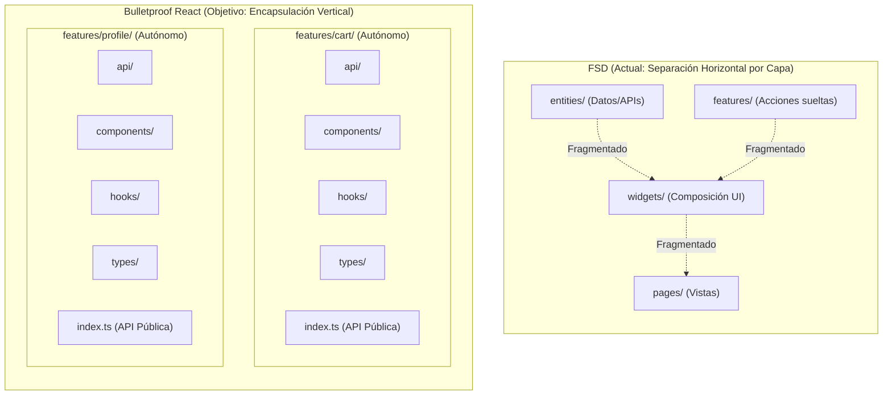
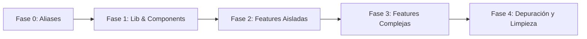

# Guía y Plan de Migración: Hacia Bulletproof React (Feature-Driven Architecture)

> **Documento de Arquitectura y Hoja de Ruta Técnica**  
> **Estado:** Propuesta Aprobada  
> **Fecha:** Octubre 2026  
> **Stack:** React 19, TypeScript, Vite, React Router 7, Zod, Vitest

---

## 1. Resumen Ejecutivo y Diagnóstico del Estado Actual

El frontend de JEPLabs fue estructurado inicialmente bajo **Feature-Sliced Design (FSD)**, una metodología creada para monorepos masivos con decenas de desarrolladores concurrentes.

Aunque FSD aporta una jerarquía estricta, en este proyecto ha generado fricción operativa considerable:

```
[ESTADO ACTUAL: FSD FRAGMENTADO]
Para trabajar en una sola funcionalidad (ej. Carrito o Perfil),
un desarrollador debe saltar entre 5 capas diferentes:

src/
├── entities/cart/model/useCartLogic.ts   <-- Lógica
├── entities/cart/api/cartApi.ts          <-- Peticiones HTTP
├── widgets/cart/CartView.tsx             <-- Componente visual
├── pages/cart/ui/CartPage.tsx            <-- Envoltorio de ruta
└── app/providers/CartProvider.tsx        <-- Contexto
```

### Principales Puntos de Dolor Identificados:
1. **Dispersión de Archivos (*Shotgun Surgery*):** Para modificar una función, hay que abrir múltiples carpetas dispersas en extremos opuestos del árbol de directorios.
2. **Frontera ambigua entre `features` y `widgets`:**
   - En *Perfil*, la UI interactiva (pestañas, formularios, modales) está en `features/profile/ui`, mientras que en `widgets/profile` quedó un componente huérfano (`ProfileView.tsx`).
   - En *Carrito*, no existe `features/cart`; toda la UI reside en `widgets/cart` y la lógica en `entities/cart`.
   - En *Checkout*, la lógica y formularios están en `features/checkout`, pero el header y los estilos generales en `widgets/checkout`.
3. **Fugas de capas e imports cruzados:**
   - `features/profile` importa hojas de estilo de `widgets/profile`, violando la regla unidireccional de FSD (una capa inferior no puede importar de una superior).
4. **Costo cognitivo innecesario:** Dudar continuamente *"¿este componente pertenece a widgets, features o entities?"* ralentiza el ritmo de desarrollo diario.

---

## 2. La Solución: Bulletproof React (BPR)

**Bulletproof React** es la arquitectura más respetada, extendida y recomendada en el ecosistema React moderno (más de 25.000 ⭐ en GitHub, impulsada y validada por ingenieros de Shopify, Vercel y Meta).

Se fundamenta en **Vertical Slices (Rebanadas Verticales)**: en lugar de dividir el código por tipo de artefacto técnico (todas las entities juntas, todos los widgets juntos), el código se agrupa por **Dominio de Negocio (Feature)**.

### Diagrama Conceptual: FSD vs. Bulletproof React



### Valor Estratégico para Entrevistas Técnicas
Adoptar Bulletproof React ofrece un relato de ingeniería sumamente valorado por Tech Leads:
- **Demuestra criterio y pragmatismo:** Demuestra que sabes identificar cuándo una arquitectura abstracta (FSD) añade sobre-ingeniería (*over-engineering*) innecesaria y tienes el criterio de migrar a una arquitectura cohesiva.
- **Estándar de facto en la industria:** Cualquier entrevistador senior de React conoce y aprueba BPR como sinónimo de código limpio, desacoplado y fácil de mantener.

---

## 3. Estructura de Directorios Objetivo

La estructura del directorio `frontend/src/` quedará organizada de la siguiente manera:

```text
frontend/src/
├── app/                          # Configuración raíz de la aplicación
│   ├── routes/                   # Definición centralizada de rutas (React Router 7)
│   └── providers/                # Composición limpia de Providers (Auth, Toast, Cart, etc.)
│
├── features/                     # ⭐ EL CORAZÓN DE LA APLICACIÓN (Vertical Slices)
│   ├── auth/                     # Autenticación, JWT doble token, listeners
│   ├── cart/                     # Carrito de compras, drawer, cálculo de precios
│   ├── catalog/                  # Catálogo de productos, filtros, búsqueda, detalle de producto
│   ├── checkout/                 # Proceso de pago, Webpay, transferencia, selección de dirección
│   ├── profile/                  # Mi cuenta, direcciones, historial de órdenes, favoritos
│   └── admin/                    # Panel de administración, gestión de usuarios, productos y órdenes
│
├── components/                   # UI Compartida y Reutilizable (UI Kit & Layout)
│   ├── ui/                       # Botones, Inputs, Modales, Spinners, Badges, etc.
│   └── layout/                   # Navbar, Footer, CategoriasNav, AdminLayout, ShopLayout
│
├── hooks/                        # Custom hooks utilitarios globales (useClickOutside, etc.)
├── lib/                          # Clientes e infraestructura (fetchWithAuth, jwt-expiry, etc.)
├── utils/                        # Funciones puras independientes (formatPrice, formatDate, etc.)
└── testing/                      # MSW Handlers, fixtures de prueba y utilidades de Vitest
```

---

## 4. Anatomía Interna de una Feature

Cada carpeta dentro de `features/[nombre]/` es un módulo autónomo con interfaces claras. Toda feature implementa la siguiente estructura:

```text
features/cart/
├── api/                          # Llamadas HTTP al backend específicas del carrito
│   └── cartApi.ts
├── components/                   # Componentes visuales pertenecientes al carrito
│   ├── CartDrawer/
│   │   ├── CartDrawer.tsx
│   │   ├── CartDrawer.module.css
│   │   └── CartDrawer.test.tsx   # Colocalización: el test vive junto al componente
│   ├── CartItem/
│   └── CartSummary/
├── hooks/                        # Lógica de negocio, timers y sincronizaciones
│   ├── useCartLogic.ts
│   └── useCartLogic.test.ts
├── types/                        # Contratos de TypeScript y esquemas Zod
│   ├── index.ts
│   └── schemas.ts
└── index.ts                      # 🚪 BARREL EXPORT: API pública del módulo
```

### La Regla de Oro: Barrel Exports (`index.ts`)
Para evitar el acoplamiento sucio (*deep imports*), los archivos fuera de una feature **solo pueden importar lo que expone su `index.ts`**:

```tsx
// ✅ CORRECTO: Se consume a través de la API pública de la feature
import { CartDrawer, useCart, type CartItem } from '@/features/cart';

// ❌ PROHIBIDO: Imports profundos dentro de la implementación privada de otra feature
import { CartDrawer } from '@/features/cart/components/CartDrawer/CartDrawer';
```

---

## 5. Matriz de Mapeo: Estado Actual vs. Bulletproof React

| Dominio | Ubicación Actual (FSD) | Nueva Ubicación (BPR) | Acciones de Limpieza |
| :--- | :--- | :--- | :--- |
| **Auth** | `features/auth` + `entities/user/api/authApi.ts` | `src/features/auth/` | Centralizar `authApi`, `useAuthLogic`, tokens y listeners en un solo módulo. |
| **Cart** | `entities/cart/` + `widgets/cart/` + `pages/cart/` | `src/features/cart/` | Unificar vista de carrito, drawer, banner de expiración y `cartApi` en un solo lugar. |
| **Profile** | `features/profile/` + `widgets/profile/` + `pages/profile/` | `src/features/profile/` | Eliminar `ProfileView.tsx` huérfano. Agrupar tabs, direcciones y favoritos. |
| **Checkout** | `features/checkout/` + `widgets/checkout/` + `entities/order/` | `src/features/checkout/` | Unificar pasos de pago, formulario de despacho y resúmenes de orden. |
| **Catalog** | `features/catalog/` + `entities/product/` + `widgets/product-detail/` | `src/features/catalog/` | Unificar listados, filtros, slider, galería de producto y tabs. |
| **Admin** | `features/admin/` + `widgets/admin/` + `pages/admin/` | `src/features/admin/` | Tablas de gestión, dashboards, formularios de creación/edición de productos y usuarios. |
| **Shared UI** | `shared/ui/` | `src/components/ui/` | Mantener UI agnóstica (`Button`, `Input`, `Select`, `Modal`, `ProductImage`). |
| **Layouts** | `widgets/layout/` | `src/components/layout/` | Mover `Navbar`, `Footer`, `ShopLayout`, `AdminLayout` a componentes de diseño compartidos. |
| **Shared Lib** | `shared/lib/` | `src/lib/` y `src/utils/` | Separar infraestructura HTTP/Tokens (`lib/`) de formateadores matemáticos/fechas (`utils/`). |

---

## 6. Plan de Implementación Paso a Paso (Paso Seguro)

Para garantizar que el sistema nunca deje de compilar y que las suites de pruebas (unitarias, router y e2e) se mantengan en verde al 100%, la migración debe realizarse en **5 fases ordenadas**:



---

### Fase 0: Configuración de Rutas y Aliases en Vite/TypeScript
**Objetivo:** Permitir que las nuevas rutas coexistan con las anteriores durante la transición sin errores de compilación.

1. Actualizar `vite.config.ts`:
   ```ts
   resolve: {
     alias: {
       '@': path.resolve(__dirname, './src'),
       '@/components': path.resolve(__dirname, './src/components'),
       '@/features': path.resolve(__dirname, './src/features'),
       '@/lib': path.resolve(__dirname, './src/lib'),
       '@/utils': path.resolve(__dirname, './src/utils'),
     }
   }
   ```
2. Replicar los paths en `tsconfig.app.json`.

---

### Fase 1: Infraestructura Compartida (`lib/`, `utils/`, `components/`)
**Objetivo:** Establecer la base compartida antes de mover los módulos de negocio.

1. Mover `src/shared/lib/http-session.ts`, `auth-token-store.ts`, `jwt-expiry.ts` a `src/lib/`.
2. Mover formateadores de precios y fechas de `shared/lib/` a `src/utils/`.
3. Mover `src/shared/ui/` a `src/components/ui/`.
4. Mover `src/widgets/layout/` (`Navbar`, `Footer`, `ShopLayout`, `AdminLayout`) a `src/components/layout/`.
5. Ejecutar suite de pruebas para confirmar retrocompatibilidad:
   ```bash
   npm test
   ```

---

### Fase 2: Consolidación de Features Aisladas (`cart`, `profile`, `auth`)
**Objetivo:** Migrar los módulos más directos y con menos dependencias cruzadas.

#### 2.1. Feature `cart`
1. Crear `src/features/cart/`.
2. Mover la lógica de `entities/cart/model/useCartLogic.ts` y sus schemas a `src/features/cart/hooks/` y `src/features/cart/types/`.
3. Mover `cartApi.ts` a `src/features/cart/api/`.
4. Mover `CartDrawer`, `CartView`, `CartExpirationBanner`, `CartExpiredModal` de `widgets/cart/` a `src/features/cart/components/`.
5. Crear `src/features/cart/index.ts` exponiendo `useCart`, `CartProvider`, `CartDrawer`, `CartView`.
6. Enrutar `pages/cart/ui/CartPage.tsx` para consumir directamente `@/features/cart`.

#### 2.2. Feature `profile`
1. Consolidar `features/profile/ui/*` dentro de `src/features/profile/components/`.
2. Mover la lógica de `entities/user/model/useProfileLogic.ts` a `src/features/profile/hooks/`.
3. Eliminar el archivo huérfano `widgets/profile/ProfileView.tsx` y migrar sus estilos directamente a `ProfilePage` o al componente principal de perfil.
4. Crear `src/features/profile/index.ts`.

#### 2.3. Feature `auth`
1. Mover `authApi.ts` desde `entities/user/api/` a `src/features/auth/api/`.
2. Centralizar `useAuthLogic.ts`, `AuthSessionListeners.tsx` y `SessionExpiryWarning.tsx` en `src/features/auth/`.
3. Crear `src/features/auth/index.ts` exponiendo `useAuth`, `AuthProvider`, `LoginForm`, `RegisterForm`.

---

### Fase 3: Consolidación de Features Complejas (`catalog`, `checkout`, `admin`)

#### 3.1. Feature `catalog`
1. Integrar en `src/features/catalog/`:
   - `entities/product/` (APIs, types, schemas).
   - `entities/category/` (APIs, types, schemas).
   - `features/catalog/` (filtros, buscador, paginación).
   - `widgets/product-detail/` (`ProductGallery`, `ProductInfo`, `ProductTabs`).
2. Crear `src/features/catalog/index.ts`.

#### 3.2. Feature `checkout`
1. Integrar en `src/features/checkout/`:
   - `features/checkout/` (formularios, validadores, pasarelas Webpay/Transferencia/QPayPro).
   - `widgets/checkout/` (`CheckoutPageHeader`, resúmenes).
   - `entities/shipping/` y `entities/address/`.
2. Crear `src/features/checkout/index.ts`.

#### 3.3. Feature `admin`
1. Consolidar paneles, tablas administrativas y modales en `src/features/admin/`.
2. Crear `src/features/admin/index.ts`.

---

### Fase 4: Limpieza, Depuración y Validación Final

1. **Eliminar directorios obsoletos:**
   - Eliminar definitivamente `src/entities/` y `src/widgets/`.
   - Eliminar `src/shared/`.
2. **Auditoría de Imports:**
   - Verificar que no queden referencias a rutas antiguas mediante búsqueda global (`git grep`).
3. **Ejecución de Pruebas de Regresión:**
   ```bash
   # Pruebas unitarias
   npm test
   
   # Compilación de producción (TypeScript + Bundler)
   npm run build
   ```

---

## 7. Argumentario Técnico para Entrevistas Laborales

Cuando te pregunten en una entrevista por la arquitectura del frontend, este es el resumen técnico recomendado:

> *"Al estructurar el frontend, evalué inicialmente **Feature-Sliced Design (FSD)**. No obstante, al implementar flujos transaccionales altamente acoplados como el Carrito o el Checkout, detectamos que separar artificialmente el código en `entities`, `features` y `widgets` introducía una sobrecarga cognitiva excesiva (*shotgun surgery*), obligando a navegar entre múltiples capas para cambios simples.*  
>  
> *Por ello, ejecuté una refactorización hacia **Bulletproof React**, basada en **Vertical Slices**. En esta arquitectura, cada dominio (Auth, Cart, Checkout, Catalog, Profile) encapsula de manera autónoma sus propios componentes, hooks, APIs y tipos, exponiendo únicamente una interfaz pública limpia mediante un `index.ts` (Barrel Export).*  
>  
> *Esta decisión optimizó el tiempo de desarrollo, garantizó la colocalización de tests y estilos, eliminó dependencias circulares y alineó el proyecto con el estándar más extendido y valorado en la industria moderna de React."*

