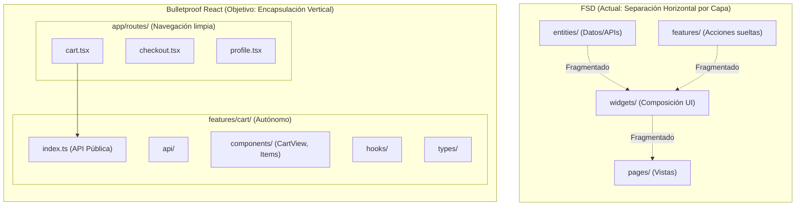
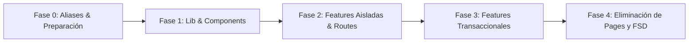

# Guía y Plan de Migración: Hacia Bulletproof React (Feature-Driven Architecture)

> **Documento de Arquitectura y Hoja de Ruta Técnica**  
> **Estado:** Propuesta Aprobada  
> **Fecha:** Noviembre 2026  
> **Stack:** React 19, TypeScript, Vite, React Router 7, Zod, Vitest  
> **Convención de Enrutamiento:** `src/app/routes/` (Routes) + `src/features/*/components/` (Views)

---

## 1. Resumen Ejecutivo y Diagnóstico del Estado Actual

El frontend de JEPLabs fue estructurado inicialmente bajo **Feature-Sliced Design (FSD)**, una metodología creada para monorepos masivos con decenas de desarrolladores concurrentes.

Aunque FSD aporta una jerarquía estricta, en este proyecto ha generado fricción operativa considerable:

```text
[ESTADO ACTUAL: FSD FRAGMENTADO]
Para trabajar en una sola funcionalidad (ej. Carrito o Perfil),
un desarrollador debe saltar entre 5 capas diferentes:

src/
├── entities/cart/model/useCartLogic.ts   <-- Lógica
├── entities/cart/api/cartApi.ts          <-- Peticiones HTTP
├── widgets/cart/CartView.tsx             <-- Componente visual
├── pages/cart/ui/CartPage.tsx            <-- Envoltorio de ruta
└── app/providers/CartProvider.tsx        <-- Contexto
```

### Principales Puntos de Dolor Identificados:
1. **Dispersión de Archivos (*Shotgun Surgery*):** Para modificar una función, hay que abrir múltiples carpetas dispersas en extremos opuestos del árbol de directorios.
2. **Frontera ambigua entre `features`, `widgets` y `entities`:**
   - En *Perfil*, la UI interactiva (pestañas, formularios, modales) está en `features/profile/ui`, mientras que en `widgets/profile` quedó un componente huérfano (`ProfileView.tsx`).
   - En *Carrito*, no existe `features/cart`; toda la UI reside en `widgets/cart` y la lógica en `entities/cart`.
   - En *Checkout*, la lógica y formularios están en `features/checkout`, pero el header y los estilos generales en `widgets/checkout`.
   - En *Sucursales y Envíos*, `entities/branch` y `entities/shipping` están desconectadas de sus flujos reales en `checkout` y `admin`.
3. **Fugas de capas e imports cruzados:**
   - `features/profile` importa hojas de estilo de `widgets/profile`, violando la regla unidireccional de FSD (una capa inferior no puede importar de una superior).
4. **Costo cognitivo innecesario:** Dudar continuamente *"¿este componente pertenece a widgets, features, entities o pages?"* ralentiza el ritmo de desarrollo diario.

---

## 2. La Solución: Bulletproof React (BPR)

**Bulletproof React** es la arquitectura más respetada, extendida y recomendada en el ecosistema React moderno (más de 25.000 ⭐ en GitHub, impulsada y validada por ingenieros de Shopify, Vercel y Meta).

Se fundamenta en **Vertical Slices (Rebanadas Verticales)**: en lugar de dividir el código por tipo de artefacto técnico (todas las entities juntas, todos los widgets juntos), el código se agrupa por **Dominio de Negocio (Feature)**.

### Diagrama Conceptual: FSD vs. Bulletproof React



---

## 3. Convención Oficial: `routes/` vs. `views` (Adiós a `pages/`)

Para evitar cualquier ambigüedad técnica y seguir fielmente la convención de Bulletproof React y React Router 7:

| Nivel | Nombre oficial | Ubicación exacta | Responsabilidad |
| :--- | :--- | :--- | :--- |
| **1. Enrutamiento (URL)** | **`Route`** | `src/app/routes/*.tsx` | Mapea 1:1 con la URL del navegador. Es una cáscara delgada (~15 líneas) que envuelve con `Suspense` o `ErrorBoundary` y monta la vista. |
| **2. Pantalla Completa** | **`View`** | `src/features/[feature]/components/*View.tsx` | Componente contenedor principal de la feature (ej. `CartView.tsx`, `CheckoutView.tsx`). Ensambla la pantalla y maneja la composición visual. |
| **3. Componentes Hijos** | **`Component`** | `src/features/[feature]/components/` | Sub-componentes propios del dominio (ej. `CartItem.tsx`, `CartSummary.tsx`, `PickupBranchSelector.tsx`). |

> [!IMPORTANT]
> **Eliminación de `src/pages/`:** En la arquitectura objetivo, la carpeta `src/pages/` **deja de existir**. Todas las pantallas se acceden como rutas en `src/app/routes/`, eliminando la duplicidad conceptual de tener carpetas `pages` y `routes` a la vez.

---

## 4. Estructura de Directorios Objetivo

La estructura del directorio `frontend/src/` quedará organizada de la siguiente manera:

```text
frontend/src/
├── app/                          # Configuración raíz de la aplicación
│   ├── routes/                   # ⭐ RUTAS DE LA APP (Mapeo 1:1 con URLs de React Router 7)
│   │   ├── home.tsx              # /
│   │   ├── catalog.tsx           # /catalogo
│   │   ├── category.tsx          # /categoria/*
│   │   ├── product.tsx           # /producto/:slug
│   │   ├── cart.tsx              # /cart
│   │   ├── checkout.tsx          # /checkout
│   │   ├── checkout-success.tsx  # /checkout/success
│   │   ├── profile.tsx           # /profile/*
│   │   ├── auth/                 # /login, /register, /reset-password
│   │   │   ├── login.tsx
│   │   │   ├── register.tsx
│   │   │   └── reset-password.tsx
│   │   ├── admin/                # /admin/* (Dashboard, Products, Orders, Users, Branches)
│   │   │   ├── dashboard.tsx
│   │   │   ├── products.tsx
│   │   │   ├── product-new.tsx
│   │   │   ├── product-edit.tsx
│   │   │   ├── users.tsx
│   │   │   ├── user-edit.tsx
│   │   │   ├── orders.tsx
│   │   │   └── branches.tsx
│   │   └── not-found.tsx         # 404
│   ├── router/                   # Configuración del Router (AppRouter, PrivateRoute, GuestRoute)
│   └── providers/                # Composición limpia de Providers globales (AppProviders)
│
├── features/                     # ⭐ EL CORAZÓN DE LA APLICACIÓN (Vertical Slices por Dominio)
│   ├── auth/                     # Autenticación, JWT doble token, listeners, login/register forms
│   ├── cart/                     # Carrito de compras, CartView, CartDrawer, cálculo de totales
│   ├── catalog/                  # Catálogo de productos, filtros, buscador, ProductDetailView
│   ├── checkout/                 # Flujo de compra, CheckoutView, pasarelas, selector de sucursal/envío
│   ├── favorites/                # Sistema de favoritos, FavoritesProvider, useFavoritesLogic
│   ├── profile/                  # Perfil de usuario, ProfileView, direcciones, historial de órdenes
│   ├── branches/                 # Gestión y datos de sucursales físicas (retiro en tienda)
│   └── admin/                    # Panel administrativo, tablas de gestión y dashboards
│
├── components/                   # UI Compartida y Reutilizable (UI Kit & Layout)
│   ├── ui/                       # Botones, Inputs, Modales, Spinners, Badges, etc.
│   └── layout/                   # Navbar, Footer, CategoriasNav, AdminLayout, ShopLayout
│
├── config/                       # ⭐ Configuración global del sistema
│   ├── env.ts                    # Variables de entorno
│   ├── constants.ts              # Constantes globales
│   └── territories/              # Localización territorial multi-país (GT y CL, regiones, comunas, departamentos)
│
├── hooks/                        # Custom hooks utilitarios globales (useClickOutside, etc.)
├── lib/                          # Clientes e infraestructura (fetchWithAuth, auth-token-store, etc.)
├── utils/                        # Funciones puras independientes (formatPrice, formatDate, etc.)
└── testing/                      # MSW Handlers, fixtures de prueba y utilidades de Vitest
```

---

## 5. Anatomía Interna de una Feature

Cada carpeta dentro de `features/[nombre]/` es un módulo autónomo con interfaces claras:

```text
features/cart/
├── api/                          # Llamadas HTTP al backend específicas del carrito
│   └── cartApi.ts
├── components/                   # Componentes visuales pertenecientes al carrito
│   ├── CartView/                 # <-- Vista principal que consume app/routes/cart.tsx
│   │   ├── CartView.tsx
│   │   ├── CartView.module.css
│   │   └── CartView.test.tsx
│   ├── CartDrawer/               # Sub-componente (drawer lateral)
│   ├── CartExpirationBanner/     # Banner de cuenta regresiva y botón de renovación
│   ├── CartExpiredModal/         # Modal de expiración y restauración de productos
│   ├── CartItem/
│   └── CartSummary/
├── hooks/                        # Lógica de negocio, timers regresivos y sincronizaciones
│   ├── useCartLogic.ts
│   └── useCartLogic.test.ts
├── types/                        # Contratos de TypeScript y esquemas Zod
│   ├── index.ts
│   └── schemas.ts
└── index.ts                      # 🚪 BARREL EXPORT: API pública del módulo
```

### La Regla de Oro: Barrel Exports (`index.ts`)
Para evitar el acoplamiento sucio (*deep imports*), los archivos fuera de una feature **solo pueden importar lo que expone su `index.ts`**:

```tsx
// ✅ CORRECTO: Se consume a través de la API pública de la feature
import { CartView, CartDrawer, useCart, type CartItem } from '@/features/cart';

// ❌ PROHIBIDO: Imports profundos dentro de la implementación privada de otra feature
import { CartView } from '@/features/cart/components/CartView/CartView';
```

### Convenciones Canónicas de Anatomía en Bulletproof React

1. **Patrón Carpeta por Componente (*Component Folder Pattern*):**
   - Cuando un componente posee archivos satélites (`.module.css`, `.test.tsx`, o sub-componentes auxiliares directos), **siempre reside en su propia carpeta**:
     ```text
     components/
     ├── CartView/
     │   ├── CartView.tsx
     │   ├── CartView.module.css
     │   └── CartView.test.tsx
     └── LoginForm/
         ├── LoginForm.tsx
         └── LoginForm.test.tsx
     ```
   - Solo se dejan planos en la raíz de `components/` aquellos componentes atómicos de un único archivo `.tsx` sin CSS dedicado ni pruebas satélites.

2. **Diferenciación Estricta: `hooks/` vs. `types/` (Adiós a `model/` de FSD):**
   - **`hooks/`:** Dedicado exclusivamente a funciones React Hook (`useCartLogic.ts`, `useAuthLogic.ts`, `useFavoritesLogic.ts`, `useProfileLogic.ts`).
   - **`types/`:** Dedicado a contratos TypeScript, DTOs y validadores Zod (`index.ts`, `schemas.ts`).
   - La carpeta `model/` (convención híbrida de FSD que mezclaba hooks con tipos) queda **formalmente abolida** en todas las features de BPR.

3. **Capa de Presentación: `components/` vs. `ui/`:**
   - Dentro de cada feature, **la capa de presentación se denomina exclusivamente `components/`**. La carpeta `ui/` no existe dentro de las features.
   - El término `ui/` queda reservado únicamente para el UI Kit agnóstico global en `src/components/ui/` (`Button`, `Input`, `Modal`, `Toast`, etc.).

4. **Autonomía de Dominio en `favorites`:**
   - La feature `favorites` no es meramente un API; es **dueña de sus propios componentes UI**:
     - `FavoriteButton`: botón de corazón reutilizable en fichas y tarjetas.
     - `FavoritesList`: lista interactiva de productos favoritos.
   - Las demás features (como `profile` o `catalog`) componen la UI de favoritos importándola desde `@/features/favorites`.

---

## 6. Matriz de Mapeo Exhaustiva: Estado Actual vs. Bulletproof React

| Dominio | Ubicación Actual (FSD) | Nueva Ubicación en BPR | Componente / Ruta Destino |
| :--- | :--- | :--- | :--- |
| **Rutas (URLs)** | `src/pages/*/ui/*Page.tsx` | `src/app/routes/*.tsx` | Mapeo 1:1 de rutas delgadas que montan las vistas de cada feature. |
| **Auth** | `features/auth/` + `entities/user/api/authApi.ts` | `src/features/auth/` | `AuthView`, `LoginForm`, `RegisterForm`, `authApi`, `useAuthLogic`, token stores. |
| **Cart** | `entities/cart/` + `widgets/cart/` + `pages/cart/` | `src/features/cart/` | `CartView`, `CartDrawer`, `CartExpiredModal`, `cartApi`, `useCartLogic`. |
| **Catalog** | `features/catalog/` + `entities/product/` + `entities/category/` + `widgets/product-detail/` | `src/features/catalog/` | `CatalogView`, `CategoryProductsView`, `ProductDetailView`, `ProductFilters`, `ProductGallery`. |
| **Checkout** | `features/checkout/` + `widgets/checkout/` + `entities/order/` + `entities/shipping/` | `src/features/checkout/` | `CheckoutView`, `CheckoutSuccessView`, pasarelas (Webpay, QPayPro, Transferencia), `orderApi`, `shippingApi`. |
| **Favorites** | `features/favorites/` + `entities/favorite/` (o sub-archivos de profile) | `src/features/favorites/` | `useFavoritesLogic`, `favoritesApi`, `FavoritesProvider`, botón toggle de favoritos. |
| **Branches** | `entities/branch/` + vistas de sucursal | `src/features/branches/` + `checkout` / `admin` | `branchApi`, `BranchApi` schemas. Selector de retiro en `checkout/`, CRUD en `admin/`. |
| **Profile** | `features/profile/` + `widgets/profile/` + `entities/user/` | `src/features/profile/` | `ProfileView`, tabs (datos, pedidos, direcciones, favoritos), `addressApi`. |
| **Admin** | `features/admin/` + `widgets/admin/` + `pages/admin/` | `src/features/admin/` | `AdminDashboardView`, `AdminProductsView`, `AdminUsersView`, `AdminOrdersView`, `AdminBranchesView`. |
| **Shared UI** | `src/shared/ui/` | `src/components/ui/` | Componentes agnósticos: `Button`, `Input`, `Select`, `Modal`, `ProductImage`, `Toast`. |
| **Layouts** | `src/widgets/layout/` | `src/components/layout/` | `Navbar`, `Footer`, `CategoriasNav`, `ShopLayout`, `AdminLayout`. |
| **Shared Lib** | `src/shared/lib/` | `src/lib/` y `src/utils/` | Clientes HTTP y sesión en `src/lib/`. Formateadores de moneda/fecha en `src/utils/`. |
| **Localización Territorial** | `src/shared/config/territories/` | `src/config/territories/` | Configuración GT/CL, departamentos/municipios, regiones/comunas y labels dinámicos. |

---

## 7. Plan de Implementación Paso a Paso (Paso Seguro)

Para garantizar que el sistema nunca deje de compilar y que las suites de pruebas (unitarias, router y e2e) se mantengan en verde al 100%, la migración debe realizarse en **5 fases ordenadas**:



---

### Fase 0: Configuración de Aliases en Vite y TypeScript `[COMPLETADA]`
**Objetivo:** Permitir que las nuevas rutas coexistan con las anteriores durante la transición sin errores de compilación.
*Estado:* ✅ Completado y verificado. Build y suite en verde.

1. Actualizar `vite.config.ts`:
   ```ts
   resolve: {
     alias: {
       '@': path.resolve(__dirname, './src'),
       '@/components': path.resolve(__dirname, './src/components'),
       '@/features': path.resolve(__dirname, './src/features'),
       '@/lib': path.resolve(__dirname, './src/lib'),
       '@/utils': path.resolve(__dirname, './src/utils'),
       '@/config': path.resolve(__dirname, './src/config'),
     }
   }
   ```
2. Replicar los paths en `tsconfig.json` manteniendo retrocompatibilidad:
   ```json
   "paths": {
       "@/*": ["src/*"],
       "@/components/*": ["src/components/*"],
       "@/features/*": ["src/features/*"],
       "@/lib/*": ["src/lib/*"],
       "@/utils/*": ["src/utils/*"],
       "@/config/*": ["src/config/*"],
       "@/entities/*": ["src/entities/*"],
       "@/widgets/*": ["src/widgets/*"],
       "@/shared/*": ["src/shared/*"],
       "@/app/*": ["src/app/*"]
   }
   ```

---

### Fase 1: Infraestructura Compartida (`lib/`, `utils/`, `config/`, `components/`) `[COMPLETADA]`
**Objetivo:** Establecer la base compartida antes de mover los módulos de negocio.
*Estado:* ✅ Completado y verificado (101 suites, 493 tests pasados). Solucionado el issue de single source of truth para `CountryCode` en `src/config/territories/`. Re-exports retrocompatibles en `src/shared/lib/` para evitar estados singletons duplicados.

1. Mover infraestructura HTTP y sesión (`src/shared/lib/http-session.ts`, `auth-token-store.ts`, `jwt-expiry.ts`) a `src/lib/`.
2. Mover formateadores puros (`format.ts`, precios, fechas) a `src/utils/`.
3. Mover la configuración territorial multi-país (`src/shared/config/territories/`) a `src/config/territories/`.
4. Mover `src/shared/ui/` (`Button`, `Modal`, `ProductImage`, `Toast`, etc.) a `src/components/ui/`.
5. Mover layouts compartidos `src/widgets/layout/` (`Navbar`, `Footer`, `ShopLayout`, `AdminLayout`) a `src/components/layout/`.
6. Ejecutar la suite completa de pruebas para asegurar que los 423 tests pasen:
   ```bash
   pnpm test
   ```

---

### Fase 2: Features Aisladas y sus Rutas (`favorites`, `auth`, `cart`, `profile`) `[COMPLETADA & HOMOGENEIZADA]`
**Objetivo:** Migrar los módulos directos aplicando fielmente la anatomía canónica BPR y el patrón de carpeta por componente.
*Estado:* ✅ Completado, homogeneizado y verificado (106 suites, 518 tests pasados, `pnpm build` limpio en 9.00s).
- **2.1 `favorites`**: 
  - `api/` (`favoritesApi.ts`).
  - `hooks/` (`useFavoritesLogic.ts`, `useFavoritesLogic.test.tsx`).
  - `types/` (`index.ts`).
  - `components/` con patrón de carpeta por componente (`FavoriteButton/`, `FavoritesList/`).
  - Barrel export en `src/features/favorites/index.ts`.
- **2.2 `auth`**: 
  - `api/` (`authApi.ts`, tests).
  - `hooks/` (`useAuthLogic.ts`, `useAuthLogic.test.ts`).
  - `types/` (`index.ts`).
  - `components/` con carpetas individuales (`LoginForm/`, `RegisterForm/`, `ForgotPasswordForm/`, `ResetPasswordForm/`, `LoginDropdown/`, `SessionExpiryWarning/`, `AuthSessionListeners/`).
  - Removido el remanente `ui/`.
  - Rutas creadas en `src/app/routes/auth/` (`login.tsx`, `register.tsx`, `reset-password.tsx`).
- **2.3 `cart`**: 
  - `api/` (`cartApi.ts`, tests).
  - `hooks/` (`useCartLogic.ts`, tests, mappers).
  - `types/` (`types.ts`, `schemas/`).
  - `components/` (`CartView/`, `CartDrawer/`, `CartExpirationBanner/`, `CartExpiredModal/`).
  - Ruta creada en `src/app/routes/cart.tsx`.
- **2.4 `profile`**: 
  - `api/` (`profileApi.ts`, tests).
  - `hooks/` (`useProfileLogic.ts`).
  - `types/` (`index.ts`).
  - `components/` (`ProfileView/`, `ProfileContent/`, `ProfileTabs/`, `ProfileDataTab/`, `AddressesTab/`, `AddressForm/`, `ChangePasswordForm/`, `OrdersTab/`, `OrderDetail/`, `OrderDetailModal/`, `FavoritesTab/` que compone `FavoritesList` de `@/features/favorites`).
  - Removido el remanente `ui/`.
  - Ruta creada en `src/app/routes/profile.tsx`.
  - Re-exports en puente para `src/shared/lib` garantizando singleton único para tokens en memoria y sesiones.

#### 2.1. Feature `favorites`
1. Consolidar en `src/features/favorites/`: `favoritesApi.ts`, `useFavoritesLogic.ts`, tipos y schemas.
2. Crear `src/features/favorites/index.ts` exponiendo `useFavoritesLogic`, `favoritesApi`.

#### 2.2. Feature `auth`
1. Mover `authApi.ts` desde `entities/user/api/` a `src/features/auth/api/`.
2. Centralizar `useAuthLogic.ts`, `AuthSessionListeners.tsx`, `LoginForm`, `RegisterForm` en `src/features/auth/`.
3. Crear las rutas en `src/app/routes/auth/`:
   - `src/app/routes/auth/login.tsx` -> renderiza `LoginForm`
   - `src/app/routes/auth/register.tsx` -> renderiza `RegisterForm`
   - `src/app/routes/auth/reset-password.tsx` -> renderiza `ResetPasswordForm`

#### 2.3. Feature `cart`
1. Consolidar en `src/features/cart/`:
   - `entities/cart/model/useCartLogic.ts` y mappers -> `hooks/useCartLogic.ts`.
   - `entities/cart/api/cartApi.ts` -> `api/cartApi.ts`.
   - `widgets/cart/CartView.tsx`, `CartDrawer.tsx`, `CartExpirationBanner.tsx`, `CartExpiredModal.tsx` -> `components/`.
2. Crear `src/features/cart/index.ts` exportando `CartView`, `CartDrawer`, `useCart`.
3. Crear la ruta `src/app/routes/cart.tsx` importando directamente `CartView` de `@/features/cart`.

#### 2.4. Feature `profile`
1. Mover `entities/user/model/useProfileLogic.ts` y `addressApi.ts` a `src/features/profile/`.
2. Consolidar tabs de perfil y el componente contenedor `ProfileView.tsx` dentro de `src/features/profile/components/`.
3. Crear la ruta `src/app/routes/profile.tsx` montando `ProfileView`.

---

### Fase 3: Features Complejas y Transaccionales (`branches`, `catalog`, `checkout`, `admin`)

#### 3.1. Feature `branches` `[COMPLETADA & VERIFICADA]`
- **Estado:** ✅ Completado, testeado (24 tests en verde) y build verificado.
- **Estructura BPR:**
  - `types/` (`api.ts`, `forms.ts`, `index.ts`).
  - `api/` (`branchApi.ts` unificando cliente y admin, tests unitarios).
  - `hooks/` (`useAdminBranches.ts`, tests).
  - `components/` con *Component Folder Pattern*:
    - `PickupBranchSelector/` (integrado en checkout).
    - `AdminBranchesTable/` (tabla responsive de gestión).
    - `BranchModalForm/` (modal con selects dinámicos para Región/Comuna o Departamento/Municipio y bloqueo de país según perfil territorial).
    - `AdminBranchesView/` (vista principal administrativa con métricas).
- **Ruta:** `src/app/routes/admin/branches.tsx`.
- **Conexiones seguras:** `useCheckoutLogic`, `ShippingServiceSelector`, `AdminBranchesPage` y `AppRouter` apuntando a `@/features/branches`. Cero archivos legacy eliminados.

#### 3.2. Feature `catalog` `[COMPLETADA & VERIFICADA]`
- **Estado:** ✅ Completado al 100%, testeado (77 tests verdes en 25 archivos de prueba dentro de `src/features/catalog`, 603 tests verdes en todo el proyecto) y compilación de producción impecable (`vite build` exitoso en 13s).
- **Diagnóstico de Ordenamiento y Paginación:** Documentado en detalle en `backend/docs/Diagnostico-Ordenamiento-Paginacion-Catalogo.md` explicando la interacción entre el corte alfabético fijo de la base de datos y el reordenamiento de la rebanada en memoria en el cliente.
- **Decisión Arquitectónica Clave:** Para evitar archivos monolíticos sobrecargados (el archivo legacy `productApi.ts` superaba las 430 líneas al mezclar lecturas del cliente con mutaciones del panel de admin), se dividió la feature en submódulos especializados:
  - `api/`:
    - `productsApi.ts`: Endpoints públicos de productos (`getById`, `getBySlug`, `getAll`, `getByCategory`). Tests unitarios en `productsApi.test.ts`.
    - `productsAdminApi.ts`: Endpoints administrativos de productos (`getAdmin`, `getByIdAdmin`, `create`, `update`, `deleteProduct`, `updateStatus`, gestión y asignación de imagen principal) para garantizar cero pérdida de funcionalidad administrativa sin acoplar código legacy. Tests en `productsAdminApi.test.ts`.
    - `categoriesApi.ts`: Endpoints de categorías y árbol jerárquico (`getAll`, `create`). Tests en `categoriesApi.test.ts`.
    - `catalogApi.ts`: Endpoint específico de búsqueda y filtrado por facetas (`/api/productos/catalogo`) con gestión de caché en memoria e invalidación. Tests en `catalogApi.test.ts`.
    - `index.ts`: Barrel export que expone la API pública con re-exportaciones explícitas sin ambigüedad (`getAllProducts`, `createProduct`, `getAllCategories`, `createCategory`) y una fachada `productApi` unificada para retrocompatibilidad 100%.
  - `types/`:
    - `product.ts`: Schemas Zod de producto, imágenes, estados, mutaciones y requests de admin. Desacoplamiento explícito de `ProductDetailViewModel` para evitar colisión nominal con el componente React `ProductDetailView`.
    - `category.ts`: Schemas Zod de categorías jerárquicas y breadcrumbs.
    - `facets.ts`: Schemas y tipos para filtros, ordenamiento, facetas y páginas Spring Data.
    - `index.ts`: Barrel export.
  - `lib/`:
    - `filter-facets.ts` & `.test.ts`: Extracción y mapeo de facetas y conteos.
    - `catalog-query-params.ts` & `.test.ts`: Sincronización bidireccional de filtros con URL search params.
    - `category-path.ts` & `.test.ts`: Búsqueda de nodo por path en árbol de categorías.
    - `category-tree.ts` & `.test.ts`: Generación de breadcrumbs y ancestros para vistas de categorías y detalle.
    - `sort-catalog-products.ts` & `.test.ts`: Algoritmos de ordenamiento en memoria y selector de criterio.
    - `product-images.ts` & `.test.ts`: Normalización de imágenes principales y placeholders.
    - `mappers.ts`: Mapeo desacoplado de view models para tarjetas y detalle.
  - `hooks/`:
    - `useProductosByCategory.ts` & `useProductosByCategory.test.ts`: Carga paginada de productos para `/categoria/*`.
    - `useProductFilterForm.ts`: Gestión de estado de filtros, borrador móvil (drawer) y reseteos.
    - `useProductDetail.ts` & `useProductDetail.test.ts`: Carga reactiva de producto por slug/id con revalidación por visibilidad y sincronización con el contexto global.
    - `index.ts`: Barrel export de hooks.
  - `components/` (*Component Folder Pattern* estricto con `.tsx`, `.module.css`, `.test.tsx`, `index.ts`):
    - `ProductCard/`: Tarjeta responsive de producto con imagen, precio formateado y botón agregar al carrito.
    - `ProductFilters/`: Panel lateral con acordeón por faceta y drawer móvil con portal en `document.body` y botón flotante FAB con badge de filtros activos (desacoplado del `.sidebar { display: none }` de desktop para visibilidad perfecta en tablet y mobile).
    - `ProductCatalog/`: Grilla de catálogo con ordenamiento, estado de carga, paginador y soporte para productos externos.
    - `CatalogView/`: Vista completa de catálogo general (`/catalogo`).
    - `CategoryProductsView/`: Vista dinámica de productos por categoría jerárquica con breadcrumbs dinámicos.
    - `ProductGallery/`: Galería interactiva con vista principal y miniaturas.
    - `ProductInfo/`: Bloque de metadatos, SKU, stock, precio, selector de cantidad, botón añadir al carrito y favoritos.
    - `ProductTabs/`: Pestañas accesibles para Descripción detallada y Especificaciones técnicas.
    - `ProductDetailView/`: Vista integral del detalle de producto (`/producto/:slug`).
  - **Rutas asociadas en `src/app/routes/`:**
    - `src/app/routes/catalog.tsx` -> para `/catalogo`
    - `src/app/routes/category.tsx` -> para `/categoria/*`
    - `src/app/routes/product.tsx` -> para `/producto/:slug`
- **Conexiones seguras y Coexistencia:**
  - `src/app/router/AppRouter.tsx` actualizado para cargar `ProductPage`, `CatalogPage` y `CategoryPage` mediante `lazy()` apuntando a `src/app/routes/*`.
  - Vistas legacy (`src/widgets/catalog/`, `src/widgets/product-detail/`, `src/widgets/layout/ProductCatalog.tsx`, `src/pages/catalog/`, `src/pages/category/`, `src/pages/product/`) delegadas limpiamente a `@/features/catalog`.
  - Cero eliminación de archivos legacy; 100% preservación de selectores CSS Modules y accesibilidad ARIA.

#### 3.3. Feature `checkout` `[COMPLETADA & VERIFICADA]`
- **Estado:** ✅ Completado al 100%, cobertura unitaria completa (268 tests verdes en 58 archivos de prueba dentro de `src/features/checkout`) y compilación de producción impecable (`vite build` exitoso).
- **Estructura Canónica en `src/features/checkout/`:**
  - `api/`: `paymentApi.ts`, `paymentGatewayApi.ts`, `orderApi.ts` (absorbido de `entities/order`), `shippingApi.ts` (absorbido de `entities/shipping`) y tests unitarios correspondientes.
  - `types/`: `paymentMethods.ts` (módulo hoja desacoplado para evitar ciclos circulares), `order.ts` (schemas y tipos de órdenes, formularios y vistas), `shipping.ts` (schemas de opciones de despacho y costos), `payment.ts` (schemas Zod de pasarelas Webpay, QPayPro, Stripe, etc.) y `checkout.ts` (steps, location states).
  - `hooks/`: `useCheckoutLogic.ts` (con named y default export, tests de polling, reanudación y flujo base), `useCheckoutSuccessRecommendations.ts`, `useOrdenesLogic.ts` (absorbido de `entities/order`) y `useEnvioOpciones.ts` (absorbido de `entities/shipping`).
  - `lib/`: `bank-transfer-accounts.ts`, `checkout-recommendations.ts`, `transfer-order-storage.ts`, `webpay-pending-order.ts`, `qpaypro-pending-order.ts`, `checkoutSteps.ts`, `orderConstants.ts`, `orderMappers.ts`, `shippingMappers.ts` (con tests unitarios para resolución de costos y selección consciente de sucursal de retiro).
  - `components/` (*Component Folder Pattern* estricto con `.tsx`, `.module.css`, `.test.tsx`, `index.ts`):
    - `CheckoutView/`: Vista principal de checkout con `CheckoutProvider` y `CheckoutContent`. Tests en `CheckoutView.test.tsx`.
    - `CheckoutSuccessView/`: Vista de confirmación con resolución por state o query param (`ordenId`), sincronización de carrito y recomendaciones. Tests en `CheckoutSuccessView.test.tsx`.
    - `CheckoutReturnView/`: Vista de retorno de pasarela Webpay (`CheckoutPageHeader` + `CheckoutReturn`). Tests en `CheckoutReturnView.test.tsx`.
    - `QPayProReturnView/`: Vista de retorno de pasarela QPayPro (`CheckoutPageHeader` + `QPayProReturn`). Tests en `QPayProReturnView.test.tsx`.
    - `CheckoutPageHeader/`: Encabezado responsive con enlace de retorno personalizable y título. Tests en `CheckoutPageHeader.test.tsx`.
    - Submódulos de formularios y pasos: `CheckoutContent`, `CheckoutSteps`, `ReviewAndShippingStep`, `PaymentStep`, `CheckoutLineItems`, `OrderSummary`, `CheckoutReservationBanner`, `BankTransferAccounts`, `BankTransferModal`, `ContraEntregaForm`, `SimulatedBankTransferForm`, `SimulatedMercadoPagoForm`, `SimulatedQPayProForm`, `SimulatedStripeForm`, `SimulatedWebpayForm`, `OrderBankTransferSection`, `OrderContraEntregaSection`, `RedirectToWebpay`, `RedirectToQPayPro`, `CheckoutReturn`, `QPayProReturn`, `ShippingAddressSelector`, `ShippingServiceSelector`, y submódulos de éxito (`CheckoutSuccessActions`, `CheckoutSuccessHeader`, `CheckoutSuccessRecommendations`, `OrderConfirmationSummary`).
  - `index.ts`: Barrel export canónico unificado que preserva 100% retrocompatibilidad con imports previos.
- **Rutas unificadas en subcarpeta `src/app/routes/checkout/`:**
  - `src/app/routes/checkout/index.tsx` -> para `/checkout` (monta `CheckoutView`)
  - `src/app/routes/checkout/success.tsx` -> para `/checkout/success` (monta `CheckoutSuccessView`)
  - `src/app/routes/checkout/webpay-return.tsx` -> para `/checkout/retorno` y `/checkout/webpay/retorno` (monta `CheckoutReturnView`)
  - `src/app/routes/checkout/qpaypro-return.tsx` -> para `/checkout/qpaypro/retorno` y `/checkout/error` (monta `QPayProReturnView`)
- **Conexiones seguras y Coexistencia:**
  - `src/app/router/AppRouter.tsx` actualizado para cargar `CheckoutPage`, `CheckoutSuccessPage`, `CheckoutReturnPage` y `QPayProReturnPage` mediante `lazy()` apuntando a `src/app/routes/checkout/*`.
  - Vistas legacy (`src/pages/checkout/`, `src/pages/checkout-success/`, `src/widgets/checkout/`) preservadas y enlazadas limpiamente a `@/features/checkout` para garantizar 100% de compatibilidad en pruebas existentes sin romper dependencias.
  - **`OrderShippingSummary` reubicado temporalmente en UI compartida (`src/components/ui/OrderShippingSummary/`):** Al ser un componente puramente presentacional consumido por `checkout` (`OrderConfirmationSummary`) y `profile` (`OrderDetail`), se movió fuera de `features/order/ui/` hacia `src/components/ui/OrderShippingSummary/` con contrato estructural sin imports hacia `features/*` (manteniendo proxy en `src/features/order/ui/OrderShippingSummary/`).

#### 3.4. Feature `admin`
1. Consolidar paneles, dashboards, tablas de productos, órdenes, usuarios y sucursales en `src/features/admin/`.
2. Crear las rutas en `src/app/routes/admin/` (`dashboard.tsx`, `products.tsx`, `orders.tsx`, `branches.tsx`, `users.tsx`).
3. Migrar `home` (`/`) y `not-found` (`*`) desde `src/pages/` hacia `src/app/routes/` (y sus componentes asociados).

---

### Evaluación Arquitectónica Pendiente (Post-`admin`): `OrderShippingSummary`, `orders` vs `checkout` en Bulletproof React

Al migrar `checkout` y `profile` detectamos un caso clásico donde se cruzan el diseño de dominio y las reglas estrictas de **Bulletproof React (BPR)** en torno a las **órdenes (`Order`)**:

#### 1. Por qué el dominio «Orden» aparece en 3 features distintas
Actualmente, el concepto de orden atraviesa tres rebanadas verticales de negocio:
- **`checkout`**: crea la orden (`crearOrden`), procesa/confirma el pago y muestra la confirmación de compra (`OrderConfirmationSummary`).
- **`profile`**: lista el historial de pedidos del cliente (`useOrdenesLogic`), abre el detalle (`OrderDetail`, `OrderDetailModal`) y permite subir comprobante de transferencia (`OrderBankTransferSection`).
- **`admin`**: gestiona y audita todas las órdenes de la tienda (`AdminOrdersView`, `AdminDashboardView`, `getOpcionesEstadoAdmin`, `actualizarEstadoOrdenAdmin`).

Por otro lado, en la estructura FSD previa existía una micro-carpeta `src/features/order/` que contenía únicamente un componente visual (`OrderShippingSummary.tsx`), usado tanto en `checkout` (`OrderConfirmationSummary`) como en `profile` (`OrderDetail`).

#### 2. Cómo lo resuelve Bulletproof React (Caminos limpios)
En BPR la regla clave es **evitar dependencias horizontales entre features** (una feature no debe importar UI privada de otra feature; las piezas comunes bajan a `src/components/` o suben a composición en `app/`). Bajo este principio, existen **dos caminos válidos**:

- **Camino 1 — `OrderShippingSummary` en `src/components/ui/` (Implementado temporalmente):**  
  [`OrderShippingSummary`](../src/components/ui/OrderShippingSummary/OrderShippingSummary.tsx) es un componente 100% presentacional (~79 líneas, sin llamadas a API ni hooks propios): únicamente recibe los datos de envío de la orden y los renderiza. Moverlo a `src/components/ui/OrderShippingSummary/` (desacoplado con un contrato estructural que no importa nada de `features/*`) elimina la micro-feature residual `features/order/` y resuelve de raíz que `checkout` y `profile` dependan entre sí a nivel de UI.

- **Camino 2 — Extraer una feature `src/features/orders/` dedicada (si crece con `admin`):**  
  Si al migrar **`admin`** se observa que `AdminOrdersView`, `OrdersTab`, `OrderDetail`, `OrderDetailModal` y `OrderBankTransferSection` comparten demasiada lógica, DTOs y componentes de gestión de pedidos, tiene sentido promover un vertical slice **`src/features/orders/`** independiente (alojando `orderApi`, `types/order`, `orderMappers`, `orderConstants`, `useOrdenesLogic`, `OrderDetail`, `OrderShippingSummary`, etc.). En ese escenario, `checkout` quedaría estrictamente acotado al flujo carrito ➔ envío ➔ pago ➔ confirmación.

#### 3. Recomendación y criterio de decisión tras migrar `admin`
- **Decisión actual:** No duplicar ni sobre-fragmentar antes de tiempo. Mantener [`OrderShippingSummary`](../src/components/ui/OrderShippingSummary/OrderShippingSummary.tsx) en `src/components/ui/` como UI compartida entre `checkout` y `profile` (con proxy de retrocompatibilidad en `src/features/order/ui/`).
- **Re-evaluación obligatoria al cerrar `admin` (antes de Fase 4):** Con todo el código de `AdminOrdersView` y `AdminDashboardView` ya migrado a BPR sobre la mesa, comparar si las dependencias de órdenes entre `checkout`, `profile` y `admin` justifican:
  1. **Mantener la distribución actual** (`OrderShippingSummary` en `src/components/ui/` + `orderApi`/`useOrdenesLogic` en `checkout`), **o bien**
  2. **Consolidar un slice `src/features/orders/`** para aislar completamente el dominio de pedidos respecto al proceso de compra (`checkout`).

---

### Fase 4: Limpieza, Eliminación de `pages/` y Validación Final

1. **Reemplazo del Router:**
   - Actualizar `src/app/router/AppRouter.tsx` para que todos los `lazy(...)` apunten a los archivos de `src/app/routes/*` en lugar de `src/pages/*`.
2. **Eliminación Definitiva de Carpetas FSD Obsoletas:**
   - Eliminar por completo la carpeta `src/pages/`.
   - Eliminar por completo la carpeta `src/widgets/`.
   - Eliminar por completo la carpeta `src/entities/`.
   - Eliminar por completo la carpeta `src/shared/`.
3. **Auditoría de Imports:**
   - Ejecutar verificación global para confirmar que ningún import intente buscar en las carpetas eliminadas:
     ```bash
     git grep -E "from '@/pages|from '@/widgets|from '@/entities|from '@/shared"
     ```
4. **Verificación de Calidad y Pruebas:**
   ```bash
   # Pruebas unitarias completas
   pnpm test
   
   # Compilación de producción (TypeScript + Rollup/Vite)
   pnpm run build
   ```

---

## 8. Argumentario Técnico para Entrevistas Laborales

Cuando te pregunten en una entrevista por la arquitectura del frontend, este es el resumen técnico recomendado:

> *"Al diseñar el frontend, evalué inicialmente **Feature-Sliced Design (FSD)**. No obstante, al escalar funcionalidades transaccionales de alto impacto como el Carrito o el Checkout con pasarelas de pago y despacho, detectamos que dividir el código en `entities`, `features`, `widgets` y `pages` generaba sobre-ingeniería (*shotgun surgery*), dispersando una sola pantalla en 4 o 5 capas distintas.*  
>  
> *Por ello, ejecutamos una refactorización limpia hacia **Bulletproof React**, basada en **Vertical Slices**. En esta arquitectura:*
> 1. *Cada dominio de negocio (`auth`, `cart`, `catalog`, `checkout`, `favorites`, `profile`, `admin`) encapsula de manera autónoma sus propias vistas (`Views`), componentes, hooks, APIs y schemas, exponiendo una API pública estricta mediante `index.ts` (Barrel Export).*  
> 2. *Las URLs de la aplicación se centralizan en `app/routes/`, eliminando la carpeta tradicional `pages` en favor de rutas delgadas y desacopladas.*  
>  
> *Esta decisión optimizó el tiempo de desarrollo, garantizó la colocalización de tests y estilos CSS Modules, eliminó dependencias circulares y alineó el proyecto con el estándar más extendido y valorado en la industria moderna de React."*
