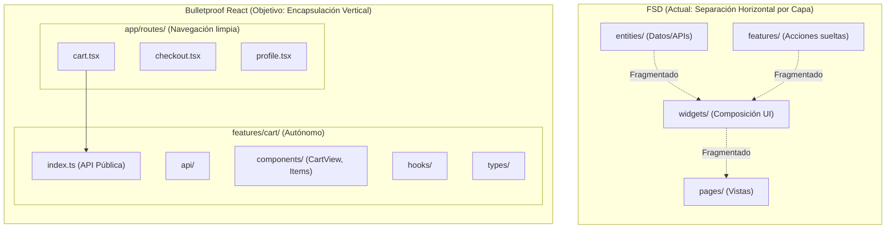
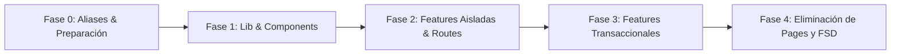

# Guía y Plan de Migración: Hacia Bulletproof React (Feature-Driven Architecture)

> **Documento de Arquitectura y Hoja de Ruta Técnica**  
> **Estado:** Propuesta Aprobada  
> **Fecha:** Noviembre 2026  
> **Stack:** React 19, TypeScript, Vite, React Router 7, Zod, Vitest  
> **Convención de Enrutamiento:** `src/app/routes/` (Routes) + `src/features/*/components/` (Views)

---

## 1. Resumen Ejecutivo y Diagnóstico del Estado Actual

El frontend de JEPLabs fue estructurado inicialmente bajo **Feature-Sliced Design (FSD)**, una metodología creada para monorepos masivos con decenas de desarrolladores concurrentes.

Aunque FSD aporta una jerarquía estricta, en este proyecto ha generado fricción operativa considerable:

```text
[ESTADO ACTUAL: FSD FRAGMENTADO]
Para trabajar en una sola funcionalidad (ej. Carrito o Perfil),
un desarrollador debe saltar entre 5 capas diferentes:

src/
├── entities/cart/model/useCartLogic.ts   <-- Lógica
├── entities/cart/api/cartApi.ts          <-- Peticiones HTTP
├── widgets/cart/CartView.tsx             <-- Componente visual
├── pages/cart/ui/CartPage.tsx            <-- Envoltorio de ruta
└── app/providers/CartProvider.tsx        <-- Contexto
```

### Principales Puntos de Dolor Identificados:
1. **Dispersión de Archivos (*Shotgun Surgery*):** Para modificar una función, hay que abrir múltiples carpetas dispersas en extremos opuestos del árbol de directorios.
2. **Frontera ambigua entre `features`, `widgets` y `entities`:**
   - En *Perfil*, la UI interactiva (pestañas, formularios, modales) está en `features/profile/ui`, mientras que en `widgets/profile` quedó un componente huérfano (`ProfileView.tsx`).
   - En *Carrito*, no existe `features/cart`; toda la UI reside en `widgets/cart` y la lógica en `entities/cart`.
   - En *Checkout*, la lógica y formularios están en `features/checkout`, pero el header y los estilos generales en `widgets/checkout`.
   - En *Sucursales y Envíos*, `entities/branch` y `entities/shipping` están desconectadas de sus flujos reales en `checkout` y `admin`.
3. **Fugas de capas e imports cruzados:**
   - `features/profile` importa hojas de estilo de `widgets/profile`, violando la regla unidireccional de FSD (una capa inferior no puede importar de una superior).
4. **Costo cognitivo innecesario:** Dudar continuamente *"¿este componente pertenece a widgets, features, entities o pages?"* ralentiza el ritmo de desarrollo diario.

---

## 2. La Solución: Bulletproof React (BPR)

**Bulletproof React** es la arquitectura más respetada, extendida y recomendada en el ecosistema React moderno (más de 25.000 ⭐ en GitHub, impulsada y validada por ingenieros de Shopify, Vercel y Meta).

Se fundamenta en **Vertical Slices (Rebanadas Verticales)**: en lugar de dividir el código por tipo de artefacto técnico (todas las entities juntas, todos los widgets juntos), el código se agrupa por **Dominio de Negocio (Feature)**.

### Diagrama Conceptual: FSD vs. Bulletproof React



---

## 3. Convención Oficial: `routes/` vs. `views` (Adiós a `pages/`)

Para evitar cualquier ambigüedad técnica y seguir fielmente la convención de Bulletproof React y React Router 7:

| Nivel | Nombre oficial | Ubicación exacta | Responsabilidad |
| :--- | :--- | :--- | :--- |
| **1. Enrutamiento (URL)** | **`Route`** | `src/app/routes/*.tsx` | Mapea 1:1 con la URL del navegador. Es una cáscara delgada (~15 líneas) que envuelve con `Suspense` o `ErrorBoundary` y monta la vista. |
| **2. Pantalla Completa** | **`View`** | `src/features/[feature]/components/*View.tsx` | Componente contenedor principal de la feature (ej. `CartView.tsx`, `CheckoutView.tsx`). Ensambla la pantalla y maneja la composición visual. |
| **3. Componentes Hijos** | **`Component`** | `src/features/[feature]/components/` | Sub-componentes propios del dominio (ej. `CartItem.tsx`, `CartSummary.tsx`, `PickupBranchSelector.tsx`). |

> [!IMPORTANT]
> **Eliminación de `src/pages/`:** En la arquitectura objetivo, la carpeta `src/pages/` **deja de existir**. Todas las pantallas se acceden como rutas en `src/app/routes/`, eliminando la duplicidad conceptual de tener carpetas `pages` y `routes` a la vez.

---

## 4. Estructura de Directorios Objetivo

La estructura del directorio `frontend/src/` quedará organizada de la siguiente manera:

```text
frontend/src/
├── app/                          # Configuración raíz de la aplicación
│   ├── routes/                   # ⭐ RUTAS DE LA APP (Mapeo 1:1 con URLs de React Router 7)
│   │   ├── home.tsx              # /
│   │   ├── catalog.tsx           # /catalogo
│   │   ├── category.tsx          # /categoria/*
│   │   ├── product.tsx           # /producto/:slug
│   │   ├── cart.tsx              # /cart
│   │   ├── checkout.tsx          # /checkout
│   │   ├── checkout-success.tsx  # /checkout/success
│   │   ├── profile.tsx           # /profile/*
│   │   ├── auth/                 # /login, /register, /reset-password
│   │   │   ├── login.tsx
│   │   │   ├── register.tsx
│   │   │   └── reset-password.tsx
│   │   ├── admin/                # /admin/* (Dashboard, Products, Orders, Users, Branches)
│   │   │   ├── dashboard.tsx
│   │   │   ├── products.tsx
│   │   │   ├── product-new.tsx
│   │   │   ├── product-edit.tsx
│   │   │   ├── users.tsx
│   │   │   ├── user-edit.tsx
│   │   │   ├── orders.tsx
│   │   │   └── branches.tsx
│   │   └── not-found.tsx         # 404
│   ├── router/                   # Configuración del Router (AppRouter, PrivateRoute, GuestRoute)
│   └── providers/                # Composición limpia de Providers globales (AppProviders)
│
├── features/                     # ⭐ EL CORAZÓN DE LA APLICACIÓN (Vertical Slices por Dominio)
│   ├── auth/                     # Autenticación, JWT doble token, listeners, login/register forms
│   ├── cart/                     # Carrito de compras, CartView, CartDrawer, cálculo de totales
│   ├── catalog/                  # Catálogo de productos, filtros, buscador, ProductDetailView
│   ├── checkout/                 # Flujo de compra, CheckoutView, pasarelas, selector de sucursal/envío
│   ├── favorites/                # Sistema de favoritos, FavoritesProvider, useFavoritesLogic
│   ├── profile/                  # Perfil de usuario, ProfileView, direcciones, historial de órdenes
│   ├── branches/                 # Gestión y datos de sucursales físicas (retiro en tienda)
│   └── admin/                    # Panel administrativo, tablas de gestión y dashboards
│
├── components/                   # UI Compartida y Reutilizable (UI Kit & Layout)
│   ├── ui/                       # Botones, Inputs, Modales, Spinners, Badges, etc.
│   └── layout/                   # Navbar, Footer, CategoriasNav, AdminLayout, ShopLayout
│
├── hooks/                        # Custom hooks utilitarios globales (useClickOutside, etc.)
├── lib/                          # Clientes e infraestructura (fetchWithAuth, auth-token-store, etc.)
├── utils/                        # Funciones puras independientes (formatPrice, formatDate, etc.)
└── testing/                      # MSW Handlers, fixtures de prueba y utilidades de Vitest
```

---

## 5. Anatomía Interna de una Feature

Cada carpeta dentro de `features/[nombre]/` es un módulo autónomo con interfaces claras:

```text
features/cart/
├── api/                          # Llamadas HTTP al backend específicas del carrito
│   └── cartApi.ts
├── components/                   # Componentes visuales pertenecientes al carrito
│   ├── CartView/                 # <-- Vista principal que consume app/routes/cart.tsx
│   │   ├── CartView.tsx
│   │   ├── CartView.module.css
│   │   └── CartView.test.tsx
│   ├── CartDrawer/               # Sub-componente (drawer lateral)
│   │   ├── CartDrawer.tsx
│   │   └── CartDrawer.module.css
│   ├── CartItem/
│   └── CartSummary/
├── hooks/                        # Lógica de negocio, timers y sincronizaciones
│   ├── useCartLogic.ts
│   └── useCartLogic.test.ts
├── types/                        # Contratos de TypeScript y esquemas Zod
│   ├── index.ts
│   └── schemas.ts
└── index.ts                      # 🚪 BARREL EXPORT: API pública del módulo
```

### La Regla de Oro: Barrel Exports (`index.ts`)
Para evitar el acoplamiento sucio (*deep imports*), los archivos fuera de una feature **solo pueden importar lo que expone su `index.ts`**:

```tsx
// ✅ CORRECTO: Se consume a través de la API pública de la feature
import { CartView, CartDrawer, useCart, type CartItem } from '@/features/cart';

// ❌ PROHIBIDO: Imports profundos dentro de la implementación privada de otra feature
import { CartView } from '@/features/cart/components/CartView/CartView';
```

---

## 6. Matriz de Mapeo Exhaustiva: Estado Actual vs. Bulletproof React

| Dominio | Ubicación Actual (FSD) | Nueva Ubicación en BPR | Componente / Ruta Destino |
| :--- | :--- | :--- | :--- |
| **Rutas (URLs)** | `src/pages/*/ui/*Page.tsx` | `src/app/routes/*.tsx` | Mapeo 1:1 de rutas delgadas que montan las vistas de cada feature. |
| **Auth** | `features/auth/` + `entities/user/api/authApi.ts` | `src/features/auth/` | `AuthView`, `LoginForm`, `RegisterForm`, `authApi`, `useAuthLogic`, token stores. |
| **Cart** | `entities/cart/` + `widgets/cart/` + `pages/cart/` | `src/features/cart/` | `CartView`, `CartDrawer`, `CartExpiredModal`, `cartApi`, `useCartLogic`. |
| **Catalog** | `features/catalog/` + `entities/product/` + `entities/category/` + `widgets/product-detail/` | `src/features/catalog/` | `CatalogView`, `CategoryProductsView`, `ProductDetailView`, `ProductFilters`, `ProductGallery`. |
| **Checkout** | `features/checkout/` + `widgets/checkout/` + `entities/order/` + `entities/shipping/` | `src/features/checkout/` | `CheckoutView`, `CheckoutSuccessView`, pasarelas (Webpay, QPayPro, Transferencia), `orderApi`, `shippingApi`. |
| **Favorites** | `features/favorites/` + `entities/favorite/` (o sub-archivos de profile) | `src/features/favorites/` | `useFavoritesLogic`, `favoritesApi`, `FavoritesProvider`, botón toggle de favoritos. |
| **Branches** | `entities/branch/` + vistas de sucursal | `src/features/branches/` + `checkout` / `admin` | `branchApi`, `BranchApi` schemas. Selector de retiro en `checkout/`, CRUD en `admin/`. |
| **Profile** | `features/profile/` + `widgets/profile/` + `entities/user/` | `src/features/profile/` | `ProfileView`, tabs (datos, pedidos, direcciones, favoritos), `addressApi`. |
| **Admin** | `features/admin/` + `widgets/admin/` + `pages/admin/` | `src/features/admin/` | `AdminDashboardView`, `AdminProductsView`, `AdminUsersView`, `AdminOrdersView`, `AdminBranchesView`. |
| **Shared UI** | `src/shared/ui/` | `src/components/ui/` | Componentes agnósticos: `Button`, `Input`, `Select`, `Modal`, `ProductImage`, `Toast`. |
| **Layouts** | `src/widgets/layout/` | `src/components/layout/` | `Navbar`, `Footer`, `CategoriasNav`, `ShopLayout`, `AdminLayout`. |
| **Shared Lib** | `src/shared/lib/` | `src/lib/` y `src/utils/` | Clientes HTTP y sesión en `src/lib/`. Formateadores de moneda/fecha en `src/utils/`. |

---

## 7. Plan de Implementación Paso a Paso (Paso Seguro)

Para garantizar que el sistema nunca deje de compilar y que las suites de pruebas (unitarias, router y e2e) se mantengan en verde al 100%, la migración debe realizarse en **5 fases ordenadas**:



---

### Fase 0: Configuración de Aliases en Vite y TypeScript
**Objetivo:** Permitir que las nuevas rutas coexistan con las anteriores durante la transición sin errores de compilación.

1. Actualizar `vite.config.ts`:
   ```ts
   resolve: {
     alias: {
       '@': path.resolve(__dirname, './src'),
       '@/components': path.resolve(__dirname, './src/components'),
       '@/features': path.resolve(__dirname, './src/features'),
       '@/lib': path.resolve(__dirname, './src/lib'),
       '@/utils': path.resolve(__dirname, './src/utils'),
     }
   }
   ```
2. Replicar los paths en `tsconfig.app.json`.

---

### Fase 1: Infraestructura Compartida (`lib/`, `utils/`, `components/`)
**Objetivo:** Establecer la base compartida antes de mover los módulos de negocio.

1. Mover `src/shared/lib/http-session.ts`, `auth-token-store.ts`, `jwt-expiry.ts` a `src/lib/`.
2. Mover formateadores de precios y fechas de `src/shared/lib/` a `src/utils/`.
3. Mover `src/shared/ui/` (`Button`, `Modal`, `ProductImage`, etc.) a `src/components/ui/`.
4. Mover `src/widgets/layout/` (`Navbar`, `Footer`, `ShopLayout`, `AdminLayout`) a `src/components/layout/`.
5. Ejecutar la suite de tests para asegurar que todo compile:
   ```bash
   pnpm test
   ```

---

### Fase 2: Features Aisladas y sus Rutas (`favorites`, `auth`, `cart`, `profile`)
**Objetivo:** Migrar los módulos más directos creando de inmediato sus rutas delgadas en `src/app/routes/`.

#### 2.1. Feature `favorites`
1. Consolidar en `src/features/favorites/`: `favoritesApi.ts`, `useFavoritesLogic.ts`, tipos y schemas.
2. Crear `src/features/favorites/index.ts` exponiendo `useFavoritesLogic`, `favoritesApi`.

#### 2.2. Feature `auth`
1. Mover `authApi.ts` desde `entities/user/api/` a `src/features/auth/api/`.
2. Centralizar `useAuthLogic.ts`, `AuthSessionListeners.tsx`, `LoginForm`, `RegisterForm` en `src/features/auth/`.
3. Crear las rutas en `src/app/routes/auth/`:
   - `src/app/routes/auth/login.tsx` -> renderiza `LoginForm`
   - `src/app/routes/auth/register.tsx` -> renderiza `RegisterForm`
   - `src/app/routes/auth/reset-password.tsx` -> renderiza `ResetPasswordForm`

#### 2.3. Feature `cart`
1. Consolidar en `src/features/cart/`:
   - `entities/cart/model/useCartLogic.ts` -> `hooks/useCartLogic.ts`.
   - `entities/cart/api/cartApi.ts` -> `api/cartApi.ts`.
   - `widgets/cart/CartView.tsx`, `CartDrawer.tsx`, `CartExpiredModal.tsx` -> `components/`.
2. Crear `src/features/cart/index.ts` exportando `CartView`, `CartDrawer`, `useCart`.
3. Crear la ruta `src/app/routes/cart.tsx` importando directamente `CartView` de `@/features/cart`.

#### 2.4. Feature `profile`
1. Mover `entities/user/model/useProfileLogic.ts` y `addressApi.ts` a `src/features/profile/`.
2. Consolidar tabs de perfil y el componente contenedor `ProfileView.tsx` dentro de `src/features/profile/components/`.
3. Crear la ruta `src/app/routes/profile.tsx` montando `ProfileView`.

---

### Fase 3: Features Complejas y Transaccionales (`branches`, `catalog`, `checkout`, `admin`)

#### 3.1. Feature `branches`
1. Consolidar contratos y `branchApi.ts` en `src/features/branches/`.
2. Exponer hooks y componentes de sucursales mediante su `index.ts`.

#### 3.2. Feature `catalog`
1. Integrar en `src/features/catalog/`:
   - `entities/product/` (APIs, schemas y mappers).
   - `entities/category/` (APIs, schemas y mappers).
   - `features/catalog/` (`useProductosByCategory`, filtros, paginación responsiva).
   - `widgets/product-detail/` (`ProductGallery`, `ProductInfo`, `ProductTabs` integrados en `ProductDetailView.tsx`).
   - `widgets/catalog/CategoryProductsView.tsx` y `ProductCatalog.tsx` -> consolidados en `CatalogView.tsx` y `CategoryView.tsx`.
2. Crear las rutas correspondientes:
   - `src/app/routes/home.tsx` -> monta `HomeView`
   - `src/app/routes/catalog.tsx` -> monta `CatalogView`
   - `src/app/routes/category.tsx` -> monta `CategoryView`
   - `src/app/routes/product.tsx` -> monta `ProductDetailView`

#### 3.3. Feature `checkout`
1. Consolidar en `src/features/checkout/`:
   - `features/checkout/` (lógica de pasos, validadores, Webpay con polling, QPayPro, Transferencia bancaria).
   - `widgets/checkout/` (`CheckoutPageHeader`, `CheckoutSuccessView`).
   - Integración de `PickupBranchSelector` (desde `branches`) y cálculo de tarifas de despacho (`shipping`).
2. Crear las rutas correspondientes:
   - `src/app/routes/checkout.tsx` -> monta `CheckoutView`
   - `src/app/routes/checkout-success.tsx` -> monta `CheckoutSuccessView`

#### 3.4. Feature `admin`
1. Consolidar paneles, dashboards, tablas de productos, órdenes, usuarios y sucursales en `src/features/admin/`.
2. Crear las rutas en `src/app/routes/admin/` (`dashboard.tsx`, `products.tsx`, `orders.tsx`, `branches.tsx`, `users.tsx`).

---

### Fase 4: Limpieza, Eliminación de `pages/` y Validación Final

1. **Reemplazo del Router:**
   - Actualizar `src/app/router/AppRouter.tsx` para que todos los `lazy(...)` apunten a los archivos de `src/app/routes/*` en lugar de `src/pages/*`.
2. **Eliminación Definitiva de Carpetas FSD Obsoletas:**
   - Eliminar por completo la carpeta `src/pages/`.
   - Eliminar por completo la carpeta `src/widgets/`.
   - Eliminar por completo la carpeta `src/entities/`.
   - Eliminar por completo la carpeta `src/shared/`.
3. **Auditoría de Imports:**
   - Ejecutar verificación global para confirmar que ningún import intente buscar en las carpetas eliminadas:
     ```bash
     git grep -E "from '@/pages|from '@/widgets|from '@/entities|from '@/shared"
     ```
4. **Verificación de Calidad y Pruebas:**
   ```bash
   # Pruebas unitarias completas
   pnpm test
   
   # Compilación de producción (TypeScript + Rollup/Vite)
   pnpm run build
   ```

---

## 8. Argumentario Técnico para Entrevistas Laborales

Cuando te pregunten en una entrevista por la arquitectura del frontend, este es el resumen técnico recomendado:

> *"Al diseñar el frontend, evalué inicialmente **Feature-Sliced Design (FSD)**. No obstante, al escalar funcionalidades transaccionales de alto impacto como el Carrito o el Checkout con pasarelas de pago y despacho, detectamos que dividir el código en `entities`, `features`, `widgets` y `pages` generaba sobre-ingeniería (*shotgun surgery*), dispersando una sola pantalla en 4 o 5 capas distintas.*  
>  
> *Por ello, ejecutamos una refactorización limpia hacia **Bulletproof React**, basada en **Vertical Slices**. En esta arquitectura:*
> 1. *Cada dominio de negocio (`auth`, `cart`, `catalog`, `checkout`, `favorites`, `profile`, `admin`) encapsula de manera autónoma sus propias vistas (`Views`), componentes, hooks, APIs y schemas, exponiendo una API pública estricta mediante `index.ts` (Barrel Export).*  
> 2. *Las URLs de la aplicación se centralizan en `app/routes/`, eliminando la carpeta tradicional `pages` en favor de rutas delgadas y desacopladas.*  
>  
> *Esta decisión optimizó el tiempo de desarrollo, garantizó la colocalización de tests y estilos CSS Modules, eliminó dependencias circulares y alineó el proyecto con el estándar más extendido y valorado en la industria moderna de React."*
